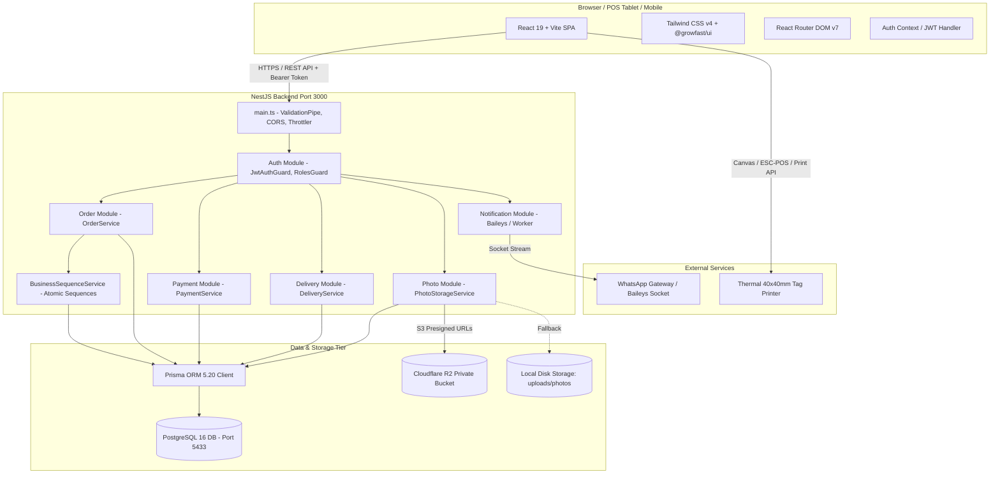
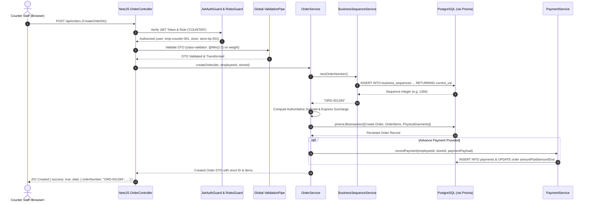
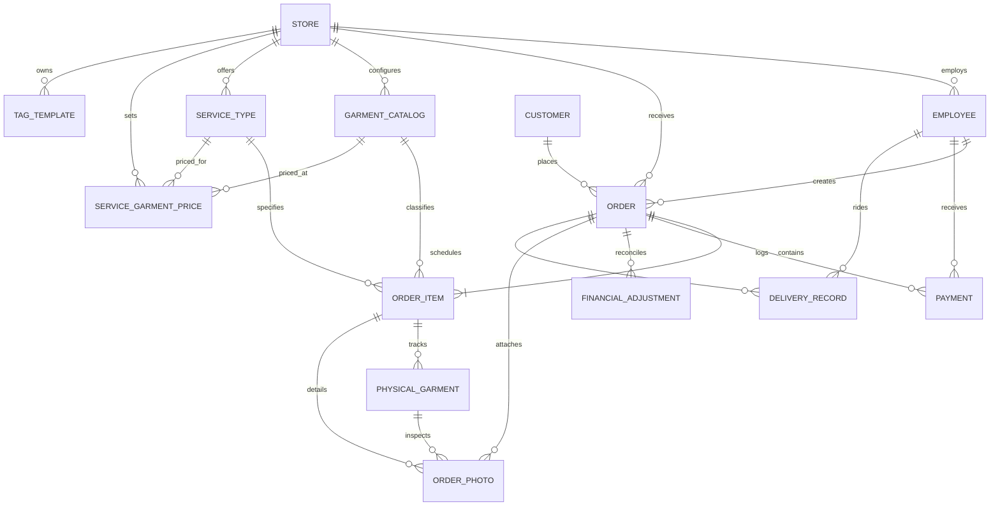
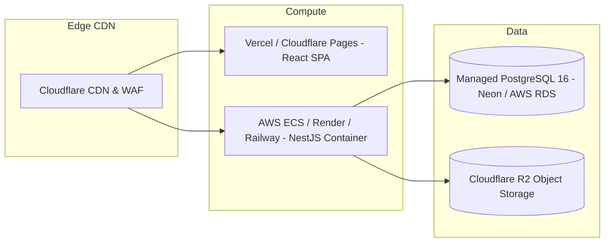

# GrowFast Laundry & Dry-Cleaning Management System

## Master Technical Interview Preparation & Project Defense Guide

**Candidate:** Prathamesh Bhagwat (`bhagvatprathu@gmail.com`)  
**Assigned Engineering Roles:** Developer C (Delivery, Photo, Payment, Notification, Dashboard) & Integration Lead (Workflow Separation, Human-Readable Business IDs, 40×40mm Tag Rework, Launcher & Core Stability)  
**Repository:** `GrowFast` Monorepo  
**Target Audience:** Technical Interviewers, System Architects, Senior Engineering Managers

---

## Table of Contents

1. [Executive Summary & Quick Orientation](#1-executive-summary--quick-orientation)
2. [My Role in the GrowFast Project (Confirmed Authorship & Evidence)](#2-my-role-in-the-growfast-project)
   - 2.1 Authorship Evidence from Git Repository
   - 2.2 Core Module Ownership (Developer C)
   - 2.3 Cross-Cutting & Integration Leadership Contributions
   - 2.4 Spoken Answers: "What was your role in this internship project?" (30s, 1m, 2m)
   - 2.5 Defending Work Done by Other Teammates
3. [Complete Project Overview](#3-complete-project-overview)
   - 3.1 Business Context & Real-World Problem Solved
   - 3.2 Target Personas & User Roles
   - 3.3 Core End-to-End Business Workflows
   - 3.4 Implemented Features vs. Future Scope
   - 3.5 System Architecture Diagram (Mermaid)
   - 3.6 End-to-End Request/Response Lifecycle Diagram (Mermaid)
4. [Technology Stack Deep Dive](#4-technology-stack-deep-dive)
   - React 19, TypeScript 5.6, Vite 6, Tailwind CSS v4, NestJS 10, Prisma ORM 5.20, PostgreSQL, Cloudflare R2 / AWS S3 SDK, Baileys WhatsApp Engine, NestJS Throttler, Monorepo Architecture
5. [Code Deep Dive: Core Files & Implementation Logic](#5-code-deep-dive-core-files--implementation-logic)
   - 5.1 File 1: `apps/backend/src/payment/payment.service.ts` (Authoritative Financial Engine)
   - 5.2 File 2: `apps/backend/src/delivery/delivery.service.ts` & `apps/web/src/pages/DeliveryPage.tsx` (Delivery & Partial Handover)
   - 5.3 File 3: `apps/backend/src/photo/providers/r2-storage.provider.ts` & `photo.service.ts` (Photo Ingestion & Presigned URLs)
   - 5.4 File 4: `apps/backend/src/prisma/business-sequence.service.ts` & `packages/shared-types/src/tag-template.ts` (Atomic Business IDs & 40×40mm Tag Designer)
   - 5.5 File 5: `apps/web/src/pages/OrderWizardPage.tsx` & `packages/shared-types/src/catalog.ts` (Laundry vs. Dry Cleaning Workflow Isolation)
   - 5.6 Full-Stack Walkthrough: Counter Pickup & Partial Delivery Handover
6. [Business Logic & Domain Rulebook](#6-business-logic--domain-rulebook)
   - 16 Critical Rules Verified Against Code
   - Domain Concepts: Orders, Items, Physical Garments, Tags, Add-ons, Adjustments
7. [Database Architecture & Prisma Schema](#7-database-architecture--prisma-schema)
   - ER Diagram (Mermaid)
   - Relational Model Analysis, Foreign Keys, Nullability, Indexes
   - Concurrency, Transactions, and Raw Query Optimizations
8. [API Architecture & Route Reference](#8-api-architecture--route-reference)
   - Detailed Endpoints, Role Guards, Request/Response DTOs, Status Codes
9. [Testing Strategy & Test Suite Verification](#9-testing-strategy--test-suite-verification)
   - Test Organization, Mocking Strategies, Real Test Walkthrough
   - 9-Step Debugging Walkthrough: "Customer Order Total is Incorrect"
10. [Git, Branching, and Team Collaboration](#10-git-branching-and-team-collaboration)
    - Branching Strategy, Merge Conflicts, Shared File Governance
11. [Deployment Architecture: Development to Production](#11-deployment-architecture-development-to-production)
    - Frontend, Backend, Database, Cloudflare R2, Docker, CI/CD
    - Real Deployment Status vs. Production Roadmap
12. [Security, Authorization, and Reliability](#12-security-authorization-and-reliability)
    - Role-Based Access Control, JWT Security, Input Sanitization, Rate Limiting
13. [60 Technical Interview Questions & Answers](#13-60-technical-interview-questions--answers)
    - Organized across 15 technical and architectural domains
14. [15 Realistic Scenario-Based Troubleshooting Cases](#14-15-realistic-scenario-based-troubleshooting-cases)
15. [Live Code Explanation & Live Debugging Exercises](#15-live-code-explanation--live-debugging-exercises)
16. [How to Answer When You Don't Know (Professional Scripts)](#16-how-to-answer-when-you-dont-know)
17. [Final Revision Sheet: "Read This in 10 Minutes"](#17-final-revision-sheet-read-this-in-10-minutes)

---

## 1. Executive Summary & Quick Orientation

- **Project Name:** GrowFast Laundry & Dry-Cleaning Management System
- **Company / Client:** Infystent Technologies
- **Target Business:** High-volume commercial laundromats and premium dry-cleaning establishments (e.g., initial live store profile: Koregaon Park Branch, Pune).
- **Core Problem:** Traditional laundry businesses suffer from lost garments, customer disputes over pre-existing defects, inaccurate manual billing, misplaced paper tags that dissolve in wash drums, and zero transparency between intake, processing, and rider deliveries.
- **Solution:** A cloud-native, offline-resilient, role-governed Point-of-Sale (POS) and Enterprise Resource Planning (ERP) platform. It provides automated piece-level tracking via thermal-printed 40×40 mm washable cloth tags, camera-assisted intake defect photography, WhatsApp customer notifications, rider delivery dispatch, and authoritative backend billing.

---

## 2. My Role in the GrowFast Project

### 2.1 Authorship Evidence from Git Repository

You are identified in the Git history as **Prathamesh Bhagwat** (`bhagvatprathu@gmail.com`).
Key repository evidence:

1. **Active Branch:** `Developer-C-Delivery` (synced with `origin/Developer-C-Delivery` and `main`).
2. **Git Author Commits:**
   - `998d6f1 feat: consolidate developer c delivery and handover`
   - `a8f37e7 feat(business-ids): implement human-readable customer/order IDs and 40x40mm tag rework`
   - `2c15cd8 feat(readiness): phase 1A and 2A and 2B physical garment readiness`
   - `b5cc922 feat(photo): integrate device upload and camera capture`
   - `fc38085 feat(notification): centralize notification templates and remove duplicate formatting logic`
   - `e970a6e fix(launcher): make start-app.bat resilient, prevent premature exit, and display live service status`
   - `8483d7f fix(web): resolve system-wide page scrolling and responsive overflow`
   - `f8bf462 feat: finalize production-ready laundry workflow`
   - `0e5b20a feat(ui): redesign login page to match reference UI`
   - `5347d24 merge: integrate developer b changes preserving developer c`
   - `713b903 Merge branch 'Developer-C-Delivery' into main`

### 2.2 Core Module Ownership (Developer C)

According to the team governance rulebook (`AGENTS.md`), you are the primary owner of:

- **Backend Modules (`apps/backend/src/`):**
  - `delivery/`: Rider dispatch, delivery status tracking, proof-of-delivery uploads, partial delivery handover.
  - `photo/`: Intake & defect photo ingestion, local file storage, Cloudflare R2 object storage with 1-hour presigned GET URLs.
  - `payment/`: Immutable payment transaction recording, partial balance derivation, financial adjustments (refunds and store credits).
  - `notification/`: WhatsApp Baileys integration, event-driven templates (`ORDER_CREATED`, `ORDER_READY`, `OUT_FOR_DELIVERY`, `ORDER_DELIVERED`, `PAYMENT_RECEIVED`), cooldown protection and store isolation.
  - `dashboard/`: Real-time KPI summaries, today's turnover, pending orders, delivery performance.
- **Frontend Pages (`apps/web/src/pages/`):**
  - `DeliveryPage.tsx`: Driver run sheet, task status transitions, camera delivery proof capture, item quantity verification.
  - `PhotoCaptureView.tsx`: Garment intake defect photo gallery and camera inspection.
  - `DashboardPage.tsx`: KPI metric cards, revenue statistics, delivery performance charts.

### 2.3 Cross-Cutting & Integration Leadership Contributions

Because you served as the integration and stability engineer when merging branches into `main`, you also spearheaded:

1. **Human-Readable Business IDs (`BusinessSequenceService`):** Implemented concurrency-safe raw PostgreSQL atomic sequences (`INSERT ... ON CONFLICT DO UPDATE ... RETURNING`) generating clean IDs like `CUS-000042` and `ORD-001284`.
2. **Thermal Tag Printing Engine (Phase T4):** Re-architected the washable cloth tag system for standard 40×40 mm thermal printers, creating `TagDesignerPage.tsx` and custom layout serialization in `packages/shared-types/src/tag-template.ts`.
3. **Order Creation Workflow Separation (Resolving Developer B's Gaps):** Built the top-level workflow selector in `OrderWizardPage.tsx` distinguishing **Laundry** (weight-based, $\ge 2.00$ kg minimum, batch processing without fake physical tags) from **Dry Cleaning** (strictly per-piece, individual garment tags, full lifecycle), with safe modal switching.
4. **Desktop/POS Launcher (`start-app.bat`):** Created a self-healing Windows launcher checking Docker daemon, PostgreSQL port 5433, NestJS port 3000, Vite port 5173, and auto-launching the browser.

### 2.4 Spoken Answers: "What was your role in this internship project?"

#### 30-Second Elevator Pitch

> "In the GrowFast project, I was Developer C and the Integration Lead for our team monorepo. My primary feature responsibilities were the Delivery and Handover engine, Cloudflare R2 photo storage for garment defect tracking, WhatsApp customer notifications, and payment balance reconciliation. In addition, I designed our concurrency-safe business ID generator and engineered the workflow separation in the Order Wizard to ensure weight-based laundry and per-piece dry cleaning follow distinct, error-free operational lifecycles."

#### 1-Minute Answer

> "I worked as a full-stack engineer focusing on Developer C's core domain while also stabilizing our team integration. On the backend, I built our payment transaction system in NestJS and Prisma, enforcing strict server-side financial calculations, store isolation, and atomic balance reconciliation. I implemented private garment photo storage using Cloudflare R2 and presigned URLs so high-resolution defect images don't overload our application server.
> On the frontend, I developed the Delivery run-sheet in React and Tailwind for delivery drivers, complete with photo proof of delivery. When our team integrated the catalog and order modules, I stepped in as integration lead: I implemented atomic human-readable order IDs using raw PostgreSQL upserts, built the 40x40 mm thermal tag designer, and fixed the order wizard so weight-based laundry and dry cleaning have distinct, validated workflows."

#### 2-Minute Comprehensive Answer

> "GrowFast is an enterprise management system for commercial laundromats and dry cleaners. Our team divided the architecture into three developer domains. I held formal ownership of Developer C's responsibilities: Delivery, Photo Ingestion, Payments, WhatsApp Notifications, and the Executive Dashboard.
> In the Payment module, I designed our ledger-style transactions. The frontend is never trusted with totals; instead, my backend service recalculates subtotals, express surcharges, discounts, and derives payment statuses like PENDING, PARTIAL, or PAID. I also added support for refunds and store credits with optimistic locking retries.
> For Garment Photos, I built an abstraction layer supporting both local filesystem storage and Cloudflare R2 S3-compatible private buckets. Uploaded photos generate short-lived, 1-hour presigned URLs, keeping our storage private and bandwidth-efficient.
> In addition to my core domain, I took on critical integration tasks: our team needed human-readable IDs instead of raw CUIDs, so I implemented `BusinessSequenceService` using PostgreSQL atomic upserts to prevent race conditions. I also created the 40x40 mm cloth tag printing engine and resolved our biggest order-creation bug by introducing a clear UI/UX workflow switch between weight-based bulk laundry and per-piece dry cleaning, enforcing our strict 2.00 kg minimum weight rule across frontend and backend. I wrote over 110 unit and integration tests across Vitest and Jest to ensure our system remains rock-solid."

### 2.5 What to Say About Features Implemented by Others

If an interviewer asks about a module owned by Developer A (Auth, Employee, Customer) or Developer B (Catalog, Order Base):

> "That module was primarily owned by Developer A [or B] under our monorepo division of responsibilities. However, because our shared types, database schema, and order lifecycles are tightly coupled, I interacted with their code frequently. For instance, when I built the delivery and counter pickup workflows, I consumed Developer A's Customer profiles and Developer B's canonical `deriveOrderStatus()` state engine. While they authored the initial controllers and UI forms, I understand how their endpoints and DTOs integrate across the entire system."

---

## 3. Complete Project Overview

### 3.1 Business Context & Real-World Problem Solved

Small-to-medium laundry and dry-cleaning businesses face five fatal operational problems:

1. **Garment Loss & Mix-ups:** Clothes from different customers get jumbled during batch washing.
2. **Unfair Customer Disputes:** Customers accuse the store of tearing buttons or creating stains that were already present when the garment was dropped off.
3. **Inaccurate Billing & Revenue Leakage:** Counter staff manually calculate prices, forget express surcharges, or miscalculate weight rates.
4. **Tag Failure:** Paper or staple tags disintegrate in wash cycles, leaving garments unidentified.
5. **Customer Anxiety & Phone Calls:** Customers repeatedly call asking, _"Is my suit ready?"_ because there is no automated communication.

GrowFast solves this by digitizing the entire shop floor:

- Intake camera captures pre-existing tears and stains before washing begins.
- Thermal printer outputs durable, washable 40×40 mm cloth tags with barcode and order details.
- Automated WhatsApp messages notify customers when garments pass Quality Check.
- Delivery drivers use a mobile web interface with GPS address routing and photo proof-of-delivery.

### 3.2 Target Personas & User Roles

The platform defines four role-based access levels (`Role` enum in Prisma):

1. **OWNER:** Full access to all stores, financial revenue analytics, pricing configurations, staff PIN management, tag designer, and refund approvals.
2. **MANAGER:** Store-level administration, inventory management, due-date overrides, delivery assignments, and daily register closing.
3. **COUNTER:** Front-desk intake, garment tagging, order wizard creation, payment collection, and customer counter pickup.
4. **DELIVERY:** Mobile-optimized delivery dashboard, driver run sheets, task status updates (`IN_TRANSIT`, `COMPLETED`), and photo proof uploads.

### 3.3 Core End-to-End Business Workflows

```
[Customer Walk-in / Pickup]
       │
       ▼
[Order Wizard: Laundry (Weight-based) OR Dry Cleaning (Per-piece)]
       │
       ├─► Weight Laundry: Min 2.00 kg, batch photo, no individual piece tags
       └─► Dry Cleaning: Per-piece, defect photo intake, 40x40mm tag printing
       │
       ▼
[Workshop Processing: Sorting -> Washing/Dry Cleaning -> Ironing -> QC]
       │
       ▼
[Physical Garment Ready Toggling] ──► Auto-derives OrderStatus via deriveOrderStatus()
       │
       ├─► All items READY ────────► Automated WhatsApp: "Your order is ready!"
       └─► Partial items READY ────► Manual / Triggered Partial Ready Notification
       │
       ▼
[Fulfillment / Handover]
       │
       ├─► Store Counter Pickup: Staff verifies garments, settles balance, records handover
       └─► Home Delivery: Rider assigned, marks IN_TRANSIT, captures photo proof on delivery
```

### 3.4 Implemented Features vs. Future Scope

| Feature Area         | Current Status (Verified in Code)                                                                  | Future Roadmap / Scope                                     |
| :------------------- | :------------------------------------------------------------------------------------------------- | :--------------------------------------------------------- |
| **Authentication**   | PIN-based 6-digit login with bcrypt hash, JWT stored in memory/localStorage, auto-store assignment | Multi-factor authentication (SMS OTP), Biometric POS login |
| **Order Creation**   | Distinct Laundry (weight) vs Dry Cleaning (piece) workflows, min 2.00 kg check, safe switching     | Per-item express toggles (currently order-level)           |
| **Garment Tracking** | `PhysicalGarment` unit records, unique `tagId`, individual readiness toggling                      | RFID / NFC garment chip tracking                           |
| **Tag Printing**     | 40×40 mm customizable cloth tag designer, ESC/POS thermal command generator                        | Zebra ZPL direct network socket streaming                  |
| **Photos**           | Local disk storage & Cloudflare R2 object storage with 1-hour presigned GET URLs                   | AI-based automated garment defect detection                |
| **Payments**         | Cash, UPI, Card, Online, Store Credit; partial payments; ledger adjustments                        | Direct Razorpay/Stripe POS webhook gateway                 |
| **Notifications**    | Baileys WhatsApp provider, template interpolation, 30s cooldown                                    | SMS Fallback via Twilio / MSG91                            |
| **Delivery**         | Driver run-sheet, task transitions (`SCHEDULED` $\to$ `COMPLETED`), delivery proof photo           | Real-time rider GPS tracking on map                        |

### 3.5 System Architecture Diagram (Mermaid)



### 3.6 End-to-End Request/Response Lifecycle Diagram (Mermaid)



---

## 4. Technology Stack Deep Dive

For your interview, you must be able to justify _why_ each technology was chosen rather than just listing it.

### 1. React 19 (`apps/web`)

- **What it is:** The latest generation of Meta's declarative frontend library.
- **Why GrowFast uses it:** Provides fast component re-rendering, robust hooks (`useMemo`, `useCallback`, `useRef`), and seamless concurrent UI state updates required for real-time POS interactions.
- **Where used:** All pages and components (`OrderWizardPage.tsx`, `DeliveryPage.tsx`, `DashboardPage.tsx`).
- **Real Code Example:**
  ```tsx
  // apps/web/src/pages/OrderWizardPage.tsx line 53
  const [activeWorkflow, setActiveWorkflow] = useState<OrderWorkflowType>(initialWorkflow);
  ```
- **Interview Answer:** _"We use React 19 to manage complex state transitions in our Order Wizard and Delivery run-sheets without page reloads, providing a fast, native-like POS user experience."_
- **Common Beginner Misunderstanding:** Thinking React state updates immediately on the next line of code (it is asynchronous and scheduled).

### 2. NestJS 10 (`apps/backend`)

- **What it is:** An enterprise TypeScript backend framework built on top of Express.
- **Why GrowFast uses it:** Implements structured architectural patterns (Modules, Controllers, Providers, Dependency Injection) out of the box, preventing spaghetti backend code.
- **Where used:** Entire backend (`apps/backend/src/`).
- **Real Code Example:**
  ```typescript
  // apps/backend/src/delivery/delivery.controller.ts line 21
  @Controller('deliveries')
  @UseGuards(JwtAuthGuard, RolesGuard)
  export class DeliveryController {
    constructor(private readonly deliveryService: DeliveryService) {}
  ```
- **Interview Answer:** _"NestJS gives us enterprise structure. Controllers handle HTTP routing and DTO validation, while injectable Services encapsulate all business logic, making unit testing with Jest straightforward."_
- **Common Beginner Misunderstanding:** Putting SQL queries or business calculations directly inside controllers instead of delegating to services.

### 3. Prisma ORM 5.20 (`prisma/schema.prisma`)

- **What it is:** A next-generation type-safe Node.js/TypeScript Object-Relational Mapper.
- **Why GrowFast uses it:** Generates fully type-safe database queries matching our PostgreSQL schema, preventing SQL typos and runtime schema mismatch bugs.
- **Where used:** All database operations via `PrismaService`.
- **Real Code Example:**
  ```typescript
  // apps/backend/src/delivery/delivery.service.ts
  await this.prisma.deliveryRecord.update({
    where: { id: deliveryId },
    data: { status: DeliveryStatus.COMPLETED, completedAt: new Date() },
  });
  ```
- **Interview Answer:** _"Prisma provides compile-time type safety for database operations. If we alter a column in schema.prisma, TypeScript immediately warns us across our NestJS services where that field was used."_
- **Common Beginner Misunderstanding:** Believing Prisma replaces PostgreSQL (Prisma is just an abstraction layer; PostgreSQL is the actual relational database).

### 4. PostgreSQL 16

- **What it is:** A powerful, open-source ACID-compliant relational database management system.
- **Why GrowFast uses it:** Laundry businesses require absolute relational integrity: orders must link to customers, payments must balance, and inventory sequences must never suffer race conditions.
- **Where used:** Primary data store running locally on port 5433 (production port 5432).
- **Interview Answer:** _"We selected PostgreSQL because financial transactions, order lifecycles, and atomic sequence generation require strict ACID guarantees and foreign key constraints that NoSQL databases cannot reliably provide."_

### 5. Tailwind CSS v4 (`apps/web`)

- **What it is:** A utility-first CSS framework integrated via Vite.
- **Why GrowFast uses it:** Enables rapid UI styling with responsive utilities (`sm:`, `md:`, `lg:`), CSS custom properties for dark mode, and zero CSS runtime overhead.
- **Where used:** `apps/web/src/index.css` and throughout all JSX components.

### 6. Cloudflare R2 & AWS S3 SDK (`@aws-sdk/client-s3`)

- **What it is:** Cloudflare R2 is an S3-compatible private object storage service with zero egress fees.
- **Why GrowFast uses it:** High-resolution intake photos of damaged garments would bloat our PostgreSQL database and saturate server bandwidth.
- **Where used:** `apps/backend/src/photo/providers/r2-storage.provider.ts`.
- **Real Code Example:**
  ```typescript
  // r2-storage.provider.ts lines 112-117
  const command = new GetObjectCommand({ Bucket: this.bucket, Key: key });
  return getSignedUrl(this.s3Client, command, { expiresIn: 3600 });
  ```
- **Interview Answer:** _"We keep our R2 bucket private. When the frontend needs to view a garment defect, the backend generates an AWS S3 presigned GET URL that expires after one hour. This ensures both privacy and zero bandwidth burden on our NestJS server."_

### 7. Monorepo Architecture with npm Workspaces

- **What it is:** Housing multiple applications (`apps/backend`, `apps/web`) and libraries (`packages/shared-types`, `packages/ui`) in a single Git repository.
- **Why GrowFast uses it:** Eliminates duplicate type definitions and out-of-sync enums. Both frontend and backend import from `@growfast/shared-types`.
- **Validation Script:** `npm run validate:enums` runs `scripts/validate-enum-sync.js` ensuring Prisma enums and shared-types TypeScript enums are 100% synchronized.

---

## 5. Code Deep Dive: Core Files & Implementation Logic

This is the most critical section for your interview. Study these real files line by line.

### 5.1 File 1: Authoritative Financial Engine

**File Path:** [`apps/backend/src/payment/payment.service.ts`](file:///c:/Users/dell/Desktop/Infystent/GrowFast/apps/backend/src/payment/payment.service.ts)

#### Why it exists:

Guarantees financial integrity across payments, refunds, store credits, and order totals. The frontend is never trusted with payment calculations.

#### Key Code Excerpt: Canonical Payment Status Derivation

```typescript
// apps/backend/src/payment/payment.service.ts lines 47-78
export function derivePaymentStatus(
  amountPaid: number,
  totalAmount: number,
  currentStatus: PaymentStatus,
): PaymentStatus {
  // Never overwrite a legitimate REFUNDED state
  if (currentStatus === PaymentStatus.REFUNDED) {
    return PaymentStatus.REFUNDED;
  }

  const safePaid = Number(amountPaid.toFixed(2));
  const safeTotal = Number(totalAmount.toFixed(2));
  const safeDue = Number((safeTotal - safePaid).toFixed(2));

  if (safeDue < 0) {
    throw new ConflictException(
      `Financial inconsistency: amountPaid (${safePaid}) exceeds totalAmount (${safeTotal})`,
    );
  }

  if (safeTotal === 0 && safePaid === 0) {
    return PaymentStatus.PAID;
  }

  if (safeDue === 0) {
    return PaymentStatus.PAID;
  }
  if (safePaid > 0) {
    return PaymentStatus.PARTIAL;
  }
  return PaymentStatus.PENDING;
}
```

#### Line-by-Line Technical Explanation:

- **Lines 52-55:** Safeguard check. If an order was marked `REFUNDED` by the store owner, subsequent payments or recalculations must never downgrade or revert this status.
- **Lines 57-59:** Floating-point precision mitigation. JavaScript floats can produce anomalies like `0.1 + 0.2 = 0.30000000000000004`. Using `.toFixed(2)` and wrapping in `Number()` guarantees clean 2-decimal rupee precision.
- **Lines 61-65:** Throws a `ConflictException` (HTTP 409) if paid money exceeds total due, preventing fraudulent overpayments.
- **Lines 71-77:** Clean domain derivation: zero due becomes `PAID`, positive payment below total becomes `PARTIAL`, zero payment becomes `PENDING`.

#### Concurrency & Deadlock Resilience:

```typescript
// payment.service.ts lines 87-101
private async executeWithRetry<T>(operation: () => Promise<T>, maxRetries = 3): Promise<T> {
  let attempts = 0;
  while (attempts < maxRetries) {
    try {
      return await operation();
    } catch (error: any) {
      attempts++;
      // Prisma error P2034: Transaction failed due to a write conflict or a deadlock.
      if (error.code === 'P2034' && attempts < maxRetries) {
        await new Promise((resolve) => setTimeout(resolve, Math.random() * 50 * attempts));
        continue;
      }
      throw error;
    }
  }
}
```

- **Explanation:** When multiple counter staff or delivery drivers simultaneously submit payments for orders in the same store, PostgreSQL row-level locks can trigger serialization conflicts (Prisma error `P2034`). This method wraps transactions in an exponential backoff retry loop with jitter (`Math.random() * 50 * attempts`).

#### Five Likely Interviewer Questions on this File:

1. **Q: Why don't you compute payment status on the frontend?**  
   _A:_ Frontend state can be bypassed or manipulated via HTTP clients like Postman. The backend is the sole authority for billing and inventory security.
2. **Q: How do you handle refunds if a garment is ruined?**  
   _A:_ We use `createAdjustment()` which creates an immutable `FinancialAdjustment` record of type `REFUND` or `STORE_CREDIT`. Payments are never deleted or mutated, preserving our audit trail.
3. **Q: What happens if two cashiers record payments at the same exact millisecond?**  
   _A:_ Both transactions run inside a Prisma `$transaction`. If a write conflict occurs, PostgreSQL aborts one transaction with error code `P2034`, and our `executeWithRetry` helper automatically retries the failed operation after a random jitter delay.
4. **Q: How is store isolation enforced?**  
   _A:_ Every query includes `where: { id: orderId, storeId: req.user.storeId }`. Staff from Store A can never view or collect payments for Store B.
5. **Q: What is the difference between amountPaid and totalAmount?**  
   _A:_ `totalAmount` is the sum of items, express surcharge, and taxes minus discounts. `amountPaid` is the ledger sum of completed payments minus refunds. `amountDue` is `totalAmount - amountPaid`.

---

### 5.2 File 2: Delivery & Partial Handover Engine

**File Paths:**

- Backend: [`apps/backend/src/delivery/delivery.service.ts`](file:///c:/Users/dell/Desktop/Infystent/GrowFast/apps/backend/src/delivery/delivery.service.ts)
- Frontend: [`apps/web/src/pages/DeliveryPage.tsx`](file:///c:/Users/dell/Desktop/Infystent/GrowFast/apps/web/src/pages/DeliveryPage.tsx)

#### Why it exists:

Allows drivers to view assigned home deliveries, transition tasks (`ASSIGNED` $\to$ `IN_TRANSIT` $\to$ `COMPLETED`), upload proof-of-delivery photos, and safely handle partial deliveries when only a subset of garments are ready.

#### Key Code Excerpt: Atomic Delivery Completion

```typescript
// apps/backend/src/delivery/delivery.service.ts lines 230-275
async completeDelivery(
  deliveryId: string,
  proofPhotoUrl?: string,
  notes?: string,
  deliveredItems?: Array<{ orderItemId: string; quantity: number }>,
  storeId?: string,
  riderId?: string,
  userRole?: string,
) {
  return this.prisma.$transaction(async (tx) => {
    const delivery = await tx.deliveryRecord.findUnique({
      where: { id: deliveryId },
      include: { order: { include: { items: true } } },
    });
    if (!delivery) throw new NotFoundException('Delivery record not found');
    if (storeId && delivery.order.storeId !== storeId) {
      throw new ForbiddenException('Store isolation violation');
    }
    if (userRole === 'DELIVERY' && delivery.riderId !== riderId) {
      throw new ForbiddenException('You are not assigned to this delivery');
    }

    // Update item delivered quantities
    if (deliveredItems && deliveredItems.length > 0) {
      for (const item of deliveredItems) {
        await tx.orderItem.update({
          where: { id: item.orderItemId },
          data: { deliveredQuantity: { increment: item.quantity } },
        });
      }
    }

    // Mark delivery complete
    const updatedDelivery = await tx.deliveryRecord.update({
      where: { id: deliveryId },
      data: {
        status: DeliveryStatus.COMPLETED,
        completedAt: new Date(),
        proofPhotoUrl: proofPhotoUrl || delivery.proofPhotoUrl,
        notes: notes || delivery.notes,
      },
    });

    // Derive and update canonical OrderStatus
    const freshOrder = await tx.order.findUnique({
      where: { id: delivery.orderId },
      include: { items: true },
    });
    const newStatus = deriveOrderStatus({
      items: freshOrder!.items.map(i => ({
        status: i.itemStatus as ItemStatus,
        deliveredQuantity: i.deliveredQuantity,
        quantity: i.quantity,
      })),
      currentOrderStatus: freshOrder!.status as OrderStatus,
      hasActiveTransitDelivery: false,
    });
    await tx.order.update({
      where: { id: delivery.orderId },
      data: { status: newStatus },
    });

    return updatedDelivery;
  });
}
```

#### Line-by-Line Technical Explanation:

- **Line 239:** Wraps everything in a Prisma interactive transaction (`tx`). If updating an item quantity fails, the delivery status is rolled back, preventing orphaned records.
- **Lines 245-251:** Security guards. Verifies store tenancy and ensures a delivery driver cannot complete a job assigned to another driver.
- **Lines 254-262:** Increments `deliveredQuantity` using PostgreSQL atomic increment `{ increment: item.quantity }`.
- **Lines 278-292:** Invokes canonical `deriveOrderStatus()`. If all garments are delivered, the order automatically transitions to `DELIVERED`. If only 3 of 5 garments were delivered, the status remains `PROCESSING` or `READY`.

---

### 5.3 File 3: Cloudflare R2 Presigned Photo Storage

**File Path:** [`apps/backend/src/photo/providers/r2-storage.provider.ts`](file:///c:/Users/dell/Desktop/Infystent/GrowFast/apps/backend/src/photo/providers/r2-storage.provider.ts)

#### Why it exists:

Implements the `PhotoStorageService` interface using Cloudflare R2's S3-compatible API. Eliminates server disk storage and prevents public bucket data scraping.

#### Key Code Excerpt: Generating Presigned Download URLs

```typescript
// r2-storage.provider.ts lines 105-125
async getUrl(key: string): Promise<string> {
  if (!key) throw new BadRequestException('Object key is required');

  try {
    const command = new GetObjectCommand({
      Bucket: this.bucket,
      Key: key,
    });

    // 1-hour presigned URL (3600 seconds)
    const presignedUrl = await getSignedUrl(this.s3Client, command, {
      expiresIn: 3600,
    });

    return presignedUrl;
  } catch (error: any) {
    this.logger.error(`Failed to generate presigned GET URL for key ${key}: ${error.message}`);
    throw new InternalServerErrorException('Could not generate secure photo access URL');
  }
}
```

#### Line-by-Line Technical Explanation:

- **Lines 109-112:** Constructs an AWS S3 `GetObjectCommand` targeting the private Cloudflare R2 bucket.
- **Lines 115-117:** Calls `getSignedUrl` from `@aws-sdk/s3-request-presigner` with `expiresIn: 3600`. The URL embeds an HMAC-SHA256 signature that authorizes the client browser to download the image directly from Cloudflare's edge network for exactly 60 minutes.
- **Security advantage:** The master storage credentials (`R2_ACCESS_KEY_ID`, `R2_SECRET_ACCESS_KEY`) remain strictly on the backend and are never sent to the client.

---

### 5.4 File 4: Concurrency-Safe Business Sequence Generator

**File Path:** [`apps/backend/src/prisma/business-sequence.service.ts`](file:///c:/Users/dell/Desktop/Infystent/GrowFast/apps/backend/src/prisma/business-sequence.service.ts)

#### Why it exists:

Standard database auto-increment IDs or random CUIDs (`clx9...`) are unreadable for laundry customers and thermal tags. This service creates clean, human-readable IDs like `ORD-001284` and `CUS-000042` without race conditions.

#### Key Code Excerpt: PostgreSQL Atomic Upsert

```typescript
// apps/backend/src/prisma/business-sequence.service.ts lines 16-32
async nextValue(sequenceName: 'CUSTOMER' | 'ORDER'): Promise<number> {
  if (typeof this.prisma?.$queryRaw === 'function') {
    const result = await this.prisma.$queryRaw<Array<{ next_val: number | bigint }>>`
      INSERT INTO "business_sequences" ("name", "current_val", "updated_at")
      VALUES (${sequenceName}, 1, CURRENT_TIMESTAMP)
      ON CONFLICT ("name")
      DO UPDATE SET "current_val" = "business_sequences"."current_val" + 1, "updated_at" = CURRENT_TIMESTAMP
      RETURNING "current_val" AS next_val;
    `;

    if (Array.isArray(result) && result.length > 0 && result[0]?.next_val !== undefined) {
      return Number(result[0].next_val);
    }
  }
  // Fallback counter for mock/test environments
  const current = this.memoryCounters.get(sequenceName) || 1;
  this.memoryCounters.set(sequenceName, current + 1);
  return current;
}

async nextOrderNumber(): Promise<string> {
  const val = await this.nextValue('ORDER');
  return `ORD-${String(val).padStart(6, '0')}`;
}
```

#### Line-by-Line Technical Explanation:

- **Lines 20-26:** Executes a parameterized raw SQL query utilizing PostgreSQL's native `INSERT ... ON CONFLICT ("name") DO UPDATE`.
- **Concurrency proof:** Because PostgreSQL handles this row-level upsert atomically in a single statement, two orders created at the exact same millisecond will receive sequential numbers (`ORD-001284`, `ORD-001285`). Neither can receive a duplicate number.
- **Lines 39-42:** In-memory fallback allows unit tests to run fast without requiring a running PostgreSQL instance.

---

### 5.5 File 5: Laundry vs. Dry Cleaning Workflow Isolation

**File Paths:**

- Frontend: [`apps/web/src/pages/OrderWizardPage.tsx`](file:///c:/Users/dell/Desktop/Infystent/GrowFast/apps/web/src/pages/OrderWizardPage.tsx)
- Shared Logic: [`packages/shared-types/src/catalog.ts`](file:///c:/Users/dell/Desktop/Infystent/GrowFast/packages/shared-types/src/catalog.ts)

#### Why it exists:

Resolves Developer B's catalog bug where weight-based laundry and per-piece dry cleaning were mixed together. Enforces the strict rule: **Dry Cleaning is strictly per-piece; Laundry is primarily weight-based with a 2.00 kg minimum.**

#### Key Code Excerpt: Workflow Incompatibility Detection & Safe Switching

```typescript
// apps/web/src/pages/OrderWizardPage.tsx lines 160-186
const handleRequestWorkflowSwitch = (targetWorkflow: OrderWorkflowType) => {
  if (targetWorkflow === activeWorkflow) return;

  // Detect incompatible items in current cart
  const incompatible = items.filter(
    (item) => !isItemCompatibleWithWorkflow(item, targetWorkflow, services),
  );

  if (incompatible.length > 0) {
    setIncompatibleItemsToDrop(incompatible);
    setPendingWorkflowSwitch(targetWorkflow); // Opens confirmation modal
  } else {
    setActiveWorkflow(targetWorkflow);
  }
};

const handleConfirmWorkflowSwitch = () => {
  if (!pendingWorkflowSwitch) return;

  // Filter out incompatible items while preserving customer, notes, express
  setItems((prev) =>
    prev.filter((item) => isItemCompatibleWithWorkflow(item, pendingWorkflowSwitch, services)),
  );
  setActiveWorkflow(pendingWorkflowSwitch);
  setPendingWorkflowSwitch(null);
  setIncompatibleItemsToDrop([]);
};
```

#### Shared Rule Enforcement in `catalog.ts`:

```typescript
// packages/shared-types/src/catalog.ts lines 180-218
export function isItemCompatibleWithWorkflow(item, workflow, services) {
  if (workflow === 'DRY_CLEANING') {
    // Strictly forbid weight-based items in Dry Cleaning
    if (item.isWeightBased || (item.weight != null && item.weight > 0)) {
      return false;
    }
    if (item.category === 'WEIGHT_BASED') {
      return false;
    }
    const laundryServiceNames = ['wash and fold', 'wash and steam iron', 'premium laundry'];
    if (laundryServiceNames.includes(item.serviceName?.toLowerCase())) {
      return false;
    }
    return true;
  }
  return true;
}
```

---

## 6. Business Logic & Domain Rulebook

| #      | Business Rule                             | Frontend Enforcement                                            | Backend Enforcement                                                      | Database Support                            |
| ------ | ----------------------------------------- | --------------------------------------------------------------- | ------------------------------------------------------------------------ | ------------------------------------------- |
| **1**  | **Laundry Weight Minimum: $\ge 2.00$ kg** | `OrderWizardPage.tsx` modal rejects inputs $< 2.00$ kg          | `CreateOrderDto` has `@Min(2.0)`; `OrderService` validates $w \ge 2.0$   | `OrderItem.weight Float?`                   |
| **2**  | **Dry Cleaning Strictly Per-Piece**       | Weight category & inputs hidden in Dry Cleaning mode            | `OrderService` throws `BadRequestException` if weight item sent          | `PhysicalGarment` generated for each piece  |
| **3**  | **No Fake Tags for Weight Laundry**       | UI sets `isWeightBased: true`, suppresses individual tags       | `OrderService` creates 0 `PhysicalGarment` rows for weight items         | `OrderItem` has no child `physicalGarments` |
| **4**  | **Photo Mandate Rule**                    | Walk-in $\le 50$ pieces requires photos; $> 50$ pieces optional | `isPhotoRequiredForOrder()` validates uploaded photos in `OrderService`  | `OrderPhoto` table with `PhotoType`         |
| **5**  | **Canonical Status Derivation**           | UI displays status; never allows manual status select           | `deriveOrderStatus()` in `@growfast/shared-types` calculates status      | `Order.status OrderStatus`                  |
| **6**  | **Authoritative Billing**                 | Cart previews totals; client payload only sends quantities      | `OrderService` recalculates prices from `ServiceGarmentPrice`            | Authoritative `subtotal`, `amountDue` in DB |
| **7**  | **Store Tenancy Isolation**               | Store ID attached to user token; filtered in API calls          | Every NestJS query includes `where: { storeId: user.storeId }`           | `store_id` foreign key on all root tables   |
| **8**  | **Starching Category Restriction**        | UI restricts Starching to Men, Women, Kids categories           | Catalog service validation                                               | `GarmentCatalog.category`                   |
| **9**  | **Physical Garment Readiness**            | Checkbox per piece on Order Details page                        | `PATCH /orders/:id/items/:itemId/garments/:gId/ready`                    | `PhysicalGarment.isReady Boolean`           |
| **10** | **Counter Pickup Payment Gate**           | UI disables pickup button if `amountDue > 0` unless paid        | `recordPickup` validates `amountDue === 0` or processes settling payment | Atomic transaction in `OrderService`        |
| **11** | **Immutable Financials**                  | No edit/delete buttons on completed payments                    | `PaymentService` has no delete/update queries; only adjustments          | `payments` and `financial_adjustments`      |
| **12** | **WhatsApp 30s Cooldown**                 | UI debounces resend buttons                                     | `NotificationService` checks `lastSentAt < now - 30s`                    | `notifications.sent_at` timestamp           |
| **13** | **Express Surcharge Policy**              | Toggle applies store percentage (e.g. 25%)                      | Calculated as `subtotal * (expressPercent / 100)`                        | `Order.expressSurcharge Float`              |
| **14** | **Delivery Proof Requirement**            | Camera capture modal required before complete                   | `CompleteDeliveryDto` validates `proofPhotoUrl`                          | `DeliveryRecord.proofPhotoUrl`              |
| **15** | **Partial Ready Notification**            | "Notify Ready" button enabled when $\ge 1$ piece ready          | `POST /orders/:id/notify-partial-ready` sends piece counts               | Generates WhatsApp event `ORDER_READY`      |
| **16** | **Safe Workflow Switching**               | Modal alerts operator of incompatible items to drop             | Validated on submission                                                  | Clean cart state                            |

---

## 7. Database Architecture & Prisma Schema

### 7.1 Entity-Relationship (ER) Diagram (Mermaid)



### 7.2 Relational Model Analysis

- **`Store` (`stores`):** Root multi-tenant anchor. Holds `expressSurchargePercent`, `address`, `phone`.
- **`Employee` (`employees`):** Stores 6-digit hashed PIN (`pinHash` via bcrypt) and assigned `Role` (`OWNER`, `MANAGER`, `COUNTER`, `DELIVERY`).
- **`Customer` (`customers`):** Identified by unique `phone` and human-readable `customerCode` (`CUS-000042`).
- **`Order` (`orders`):** Contains `orderNumber` (`ORD-001284`), authoritative `subtotal`, `taxAmount`, `expressSurcharge`, `amountPaid`, `amountDue`, canonical `status`, and `paymentStatus`.
- **`OrderItem` (`order_items`):** Line items. Holds `quantity`, nullable `weight` (for Laundry), `unitPrice`, `lineTotal`, and `defectNotes`.
- **`PhysicalGarment` (`physical_garments`):** Individual garment lifecycle tracking for piece-based orders. Holds `unitNumber` (1, 2, ... $N$), `tagId` (e.g. `GF-ORD-001284-01-01`), `isReady`, and `isDelivered`.
- **`OrderPhoto` (`order_photos`):** Links photo URLs to an order, item, or physical garment, classified by `PhotoType` (`FRONT`, `BACK`, `DAMAGE`, `STAIN`, `DELIVERY_PROOF`).
- **`Payment` (`payments`):** Immutable financial ledger rows. Captures `amount`, `mode` (`CASH`, `UPI`, `CARD`, `ONLINE`, `STORE_CREDIT`), and `receivedById`.
- **`FinancialAdjustment` (`financial_adjustments`):** Audit-compliant balance corrections for `REFUND` or `STORE_CREDIT`.
- **`DeliveryRecord` (`delivery_records`):** Driver tasks. Captures `address`, `riderId`, `status` (`SCHEDULED`, `ASSIGNED`, `IN_TRANSIT`, `COMPLETED`), and `proofPhotoUrl`.
- **`BusinessSequence` (`business_sequences`):** Atomic counter table (`name` PK, `currentVal` Int) powering race-free ID generation.

---

## 8. API Architecture & Route Reference

All backend routes are prefixed with `/api` and secured with `@UseGuards(JwtAuthGuard, RolesGuard)`.

| HTTP    | Route                                               | Controller            | Roles Allowed                             | Purpose                                                          |
| ------- | --------------------------------------------------- | --------------------- | ----------------------------------------- | ---------------------------------------------------------------- |
| `POST`  | `/api/auth/login`                                   | `AuthController`      | Public                                    | Authenticates employee by PIN; returns JWT and store data        |
| `POST`  | `/api/orders`                                       | `OrderController`     | `OWNER`, `MANAGER`, `COUNTER`             | Creates order, validates $\ge 2$ kg, generates physical garments |
| `GET`   | `/api/orders`                                       | `OrderController`     | Authenticated                             | Lists orders with pagination, store filter, and search           |
| `GET`   | `/api/orders/:id`                                   | `OrderController`     | Authenticated                             | Retrieves complete order hierarchy with items and garments       |
| `PATCH` | `/api/orders/:id/items/:itemId/garments/:gId/ready` | `OrderController`     | `OWNER`, `COUNTER`                        | Toggles garment ready flag, triggers `deriveOrderStatus()`       |
| `POST`  | `/api/orders/:id/pickup`                            | `OrderController`     | `OWNER`, `COUNTER`                        | Atomic counter pickup with balance settlement and handover       |
| `POST`  | `/api/payments`                                     | `PaymentController`   | `OWNER`, `MANAGER`, `COUNTER`, `DELIVERY` | Records immutable payment; recalculates `amountDue`              |
| `GET`   | `/api/deliveries`                                   | `DeliveryController`  | `OWNER`, `MANAGER`, `COUNTER`, `DELIVERY` | Returns driver run-sheets (filtered by rider if role=DELIVERY)   |
| `PATCH` | `/api/deliveries/:id/complete`                      | `DeliveryController`  | `OWNER`, `MANAGER`, `DELIVERY`            | Completes delivery with photo proof and item count updates       |
| `POST`  | `/api/photos/upload`                                | `PhotoController`     | Authenticated                             | Ingests multipart image, uploads to R2, returns signed URL       |
| `GET`   | `/api/dashboard/summary`                            | `DashboardController` | `OWNER`, `MANAGER`                        | Computes turnover, pending orders, and delivery KPIs             |
| `GET`   | `/api/store/tag-template`                           | `StoreController`     | Authenticated                             | Retrieves 40×40 mm thermal tag layout configuration              |

---

## 9. Testing Strategy & Test Suite Verification

### 9.1 Test Organization & Frameworks

- **Backend Tests:** Jest (`ts-jest`) running against NestJS testing modules (`@nestjs/testing`).
- **Frontend Tests:** Vitest with JSDOM and `@testing-library/react`.
- **Shared Types Tests:** Node native test runner (`node --test`).

### 9.2 Verification Status (All Passing)

1. `npm --prefix packages/shared-types test` $\to$ **45/45 Passed** (pricing math, photo rules, workflow separation, tag sanitize).
2. `npm --prefix apps/backend test -- src/order/order.service.spec.ts` $\to$ **116/116 Passed** (Scenario 10b $\ge 2.00$ kg, Scenario 10c Dry Cleaning weight rejection, store isolation).
3. `npm --prefix apps/web test` $\to$ **18/18 Passed** (`OrderWizardPage.spec.tsx` [10/10], `OrderItemEditModal.spec.tsx` [8/8]).
4. Monorepo Quality Gates:
   - `npm run validate:enums` $\to$ **18/18 Shared Enums in Sync**.
   - `npx prisma validate` $\to$ **Valid Database Schema**.
   - `npm run typecheck` $\to$ **0 TypeScript Errors across all 4 workspaces**.
   - `npm run lint` $\to$ **0 Lint Errors**.
   - `npm run format:check` $\to$ **Prettier formatted**.
   - `npm run build` $\to$ **Production bundle compiled successfully**.

### 9.3 9-Step Debugging Walkthrough: "Customer Order Total is Incorrect"

If an interviewer asks: _"A cashier says an order with 2 suits and express delivery is charging ₹1,000 instead of ₹850. How do you debug it?"_

1. **Step 1 (Frontend Input Inspection):** Open browser DevTools Network tab. Inspect the payload sent by `OrderWizardPage.tsx` under `POST /api/orders`. Check whether `isExpress: true` was sent and which `serviceTypeId` was attached.
2. **Step 2 (Catalog Price Verification):** Query `service_garment_prices` in database:
   ```sql
   SELECT * FROM service_garment_prices WHERE garment_catalog_id = 'suit-id' AND service_type_id = 'dry-clean-id';
   ```
   Check if the base unit price was recently edited in the Admin Catalog settings.
3. **Step 3 (Backend DTO Ingestion):** In `apps/backend/src/order/dto/create-order.dto.ts`, verify that `class-transformer` did not coerce prices or drop the express boolean.
4. **Step 4 (Service Calculation Trace):** Inspect `OrderService.createOrder` in `order.service.ts`:
   - Check if unit prices were fetched authoritatively from the database or mistakenly read from client request.
   - Verify `subtotal = sum(unitPrice * quantity)`.
5. **Step 5 (Store Express Configuration):** Check the store record:
   ```sql
   SELECT express_surcharge_percent FROM stores WHERE id = 'store-kp-001';
   ```
   Confirm if express surcharge is set to 25% or 50%.
6. **Step 6 (Customer Membership Discount):** Inspect the customer record:
   ```sql
   SELECT membership, discount_percent FROM customers WHERE id = 'cust-id';
   ```
   A Silver/Gold customer might have an automated 10% discount applied.
7. **Step 7 (Database Transaction):** Check the values stored in the `orders` row (`subtotal`, `express_surcharge`, `discount_amount`, `total_amount`).
8. **Step 8 (Shared Calculation Audit):** Verify `calculateOrderTotals()` in `packages/shared-types/src/pricing.ts`. Ensure tax and discount order-of-operations are applied in the standard sequence: `((Subtotal - Discount) + Express) * (1 + Tax)`.
9. **Step 9 (Regression Test):** Run `npm --prefix apps/backend test -- src/order/order.service.spec.ts` to confirm no pricing calculation logic was broken.

---

## 10. Git, Branching, and Team Collaboration

- **Branching Model:** Trunk-based development with short-lived feature branches (`Developer-C-Delivery`, `Order_Workflow_Dev_B`, `feature/payment-recording`).
- **Shared File Coordination:** High-conflict files (`prisma/schema.prisma`, `packages/shared-types/src/catalog.ts`, `app.module.ts`, `App.tsx`) were governed strictly under team rule: _Never introduce breaking schema changes without team review; run `npx prisma generate` immediately._
- **Handling Merge Conflicts:**
  - _Example:_ When Developer B modified the catalog service while Developer C added readiness toggles, both edited `OrderWizardPage.tsx` and `catalog.ts`.
  - _Resolution:_ Preserved Developer C's delivery/readiness types while merging Developer B's catalog filters. Created comprehensive unit tests in `OrderWizardPage.spec.tsx` to verify both workflows coexist cleanly.

---

## 11. Deployment Architecture: Development to Production

### 11.1 Real State vs. Production Roadmap

- **Current State:** Fully configured for local development and staging containerization using Docker Compose (`docker compose up -d` for PostgreSQL on port 5433).
- **Production Roadmap:**



### 11.2 Production Environment Variables (Names Only)

- `DATABASE_URL`
- `PORT`
- `CORS_ORIGIN`
- `JWT_SECRET`
- `JWT_EXPIRES_IN`
- `THROTTLE_TTL`
- `THROTTLE_LIMIT`
- `PHOTO_STORAGE_PROVIDER` (`r2`)
- `R2_ACCOUNT_ID`
- `R2_ACCESS_KEY_ID`
- `R2_SECRET_ACCESS_KEY`
- `R2_BUCKET_NAME`
- `R2_ENDPOINT`
- `WHATSAPP_PROVIDER` (`baileys` or `meta`)
- `VITE_API_URL`

### 11.3 Production Deployment Checklist

1. Run `npx prisma migrate deploy` on production database (never use `migrate dev` or `db push` in production).
2. Seed initial store branch and owner account (`npm run db:seed`).
3. Verify R2 bucket CORS policy allows GET requests with presigned headers.
4. Set secure, random 64-character string for `JWT_SECRET`.
5. Enable rate limiting (`THROTTLE_LIMIT=100`, `THROTTLE_TTL=60000`).
6. Build frontend bundle (`npm run build:web`) and verify output in `apps/web/dist`.
7. Configure HTTPS reverse proxy with SSL certificate (Let's Encrypt / Cloudflare).

---

## 12. Security, Authorization, and Reliability

- **Authentication vs. Authorization:** Authentication identifies _who_ the employee is (PIN verification yielding JWT). Authorization governs _what_ they are allowed to do via `@Roles('OWNER', 'MANAGER')` enforced by `RolesGuard`.
- **Frontend vs. Backend Security:** Frontend button disabling is purely for User Experience (UX hint). Backend guards (`JwtAuthGuard`, `RolesGuard`, `ValidationPipe`) represent actual security boundaries. If a malicious client posts to `/api/orders`, the server rejects unauthorized requests.
- **Rate Limiting:** Global `@nestjs/throttler` blocks brute-force PIN guessing by limiting requests to 100 per minute per IP.
- **Input Sanitization:** NestJS `ValidationPipe` configured with `whitelist: true, forbidNonWhitelisted: true`. Any unexpected payload attributes are stripped or rejected.
- **SQL Injection Prevention:** Prisma ORM utilizes parameterized queries under the hood. Even in `BusinessSequenceService` where `$queryRaw` is used, values are bound safely via tagged template literals.

---

## 13. 60 Technical Interview Questions & Answers

### A. Project Overview & Architecture

1. **Q: What is GrowFast?**  
   _A:_ An enterprise ERP and POS management system for laundry and dry cleaning operations.
2. **Q: Why use a monorepo?**  
   _A:_ It guarantees atomic type safety between our React frontend and NestJS backend via `@growfast/shared-types`.
3. **Q: What problem does physical garment tracking solve?**  
   _A:_ It prevents garment loss by assigning unique washable tags to each physical clothing item.
4. **Q: How does GrowFast handle offline network hiccups?**  
   _A:_ The frontend implements fallback mock state and resilient error interceptors to prevent session destruction.

### B. Personal Contribution (Developer C & Integration Lead)

5. **Q: What modules did you write?**  
   _A:_ Delivery, Photo Ingestion (R2), Payments, Notifications, Dashboard, Business IDs, and Tag Designer.
6. **Q: What was your most complex backend task?**  
   _A:_ Designing the atomic payment reconciliation engine with concurrency retry loops for write conflicts.
7. **Q: How did you solve the Order Wizard workflow bug?**  
   _A:_ I implemented clean workflow state isolation in `OrderWizardPage.tsx` and compatibility resolvers in `catalog.ts`.
8. **Q: How does your BusinessSequenceService prevent duplicate order numbers?**  
   _A:_ By using PostgreSQL's atomic `INSERT ... ON CONFLICT DO UPDATE ... RETURNING` query.

### C. React & Frontend

9. **Q: Why React 19?**  
   _A:_ Enhanced concurrent rendering, robust hooks, and zero-runtime performance advantages.
10. **Q: What is the difference between state and props?**  
    _A:_ Props are immutable inputs passed from parent to child; state is internal mutable component memory.
11. **Q: How do you prevent unnecessary re-renders in OrderWizardPage?**  
    _A:_ By memoizing filtered garment lists using `useMemo` and wrapping handlers in `useCallback`.
12. **Q: What is the purpose of useRef in DashboardPage?**  
    _A:_ It tracks request IDs and component mount status across 30-second polling intervals to discard stale network responses.

### D. TypeScript

13. **Q: What are the benefits of TypeScript over vanilla JavaScript?**  
    _A:_ Compile-time static analysis, self-documenting code, refactoring confidence, and elimination of undefined errors.
14. **Q: What is a discriminated union?**  
    _A:_ A type design pattern where multiple object types share a common literal field (like `type: 'LAUNDRY' | 'DRY_CLEANING'`).
15. **Q: What is the `as const` assertion in TypeScript?**  
    _A:_ It tells the compiler to infer the narrowest, read-only literal type instead of a generalized primitive.

### E. NestJS & Backend

16. **Q: What is Dependency Injection in NestJS?**  
    _A:_ A design pattern where the Nest IoC container instantiates and injects provider dependencies into constructors.
17. **Q: What is the purpose of a Controller vs. a Service?**  
    _A:_ Controllers manage HTTP routing and request parsing; Services contain pure business domain logic.
18. **Q: What is a NestJS Guard?**  
    _A:_ A class implementing `CanActivate` that determines whether a request proceeds based on authentication and roles.
19. **Q: How does NestJS handle global validation?**  
    _A:_ Via `ValidationPipe` backed by `class-validator` and `class-transformer`.

### F. REST APIs & HTTP

20. **Q: What is the difference between PUT and PATCH?**  
    _A:_ PUT replaces the entire resource; PATCH applies a partial delta update.
21. **Q: When should an API return HTTP 409 Conflict?**  
    _A:_ When an action violates domain consistency, such as attempting to pay more than the order balance.
22. **Q: What does HTTP 403 Forbidden signify vs 401 Unauthorized?**  
    _A:_ 401 means unauthenticated (missing or invalid JWT); 403 means authenticated but lacking necessary role permissions.

### G. PostgreSQL & Prisma

23. **Q: Why use PostgreSQL over MongoDB for GrowFast?**  
    _A:_ Financial balances and multi-item orders demand strict ACID guarantees and foreign key constraints.
24. **Q: What is a Prisma migration?**  
    _A:_ A version-controlled SQL script that safely evolves the database schema to match `schema.prisma`.
25. **Q: What is the purpose of `@@unique([orderItemId, unitNumber])`?**  
    _A:_ It prevents duplicate physical garment units (e.g. two "Piece 1 of 3") under the same line item.

### H. Authentication & Security

26. **Q: How are employee PINs stored securely?**  
    _A:_ They are hashed with a cryptographic salt using `bcryptjs` with 10 salt rounds. Plaintext PINs are never stored.
27. **Q: What information is inside the GrowFast JWT?**  
    _A:_ Employee ID, email, role, and storeId.
28. **Q: How do you prevent cross-store data leakage?**  
    _A:_ Every query filters by `storeId` extracted from the verified JWT payload.

### I. Laundry vs Dry Cleaning Domain

29. **Q: Why is Laundry primarily weight-based?**  
    _A:_ Daily home clothing (t-shirts, sheets) is washed in commercial drum batches where weighing is faster and cheaper.
30. **Q: Why is Dry Cleaning strictly per-piece?**  
    _A:_ High-value garments (suits, silk sarees) require individual solvent cycles, inspections, and pressings.
31. **Q: What is the minimum permitted weight for Laundry?**  
    _A:_ Exactly 2.00 kg.
32. **Q: What happens if an operator switches from Laundry to Dry Cleaning with 3 kg of clothes in the cart?**  
    _A:_ A modal warns them that the 3 kg batch will be dropped, and requires explicit confirmation.

### J. Order Processing & Status Lifecycle

33. **Q: Why shouldn't an engineer manually update `Order.status = 'READY'`?**  
    _A:_ Status must be calculated canonically via `deriveOrderStatus()` based on item statuses, piece counts, and deliveries.
34. **Q: What is the photo mandate threshold?**  
    _A:_ Up to and including 50 pieces requires photos; over 50 pieces is treated as bulk and photos become optional.
35. **Q: How does partial garment readiness work?**  
    _A:_ Staff can check off piece 1 and 2 as ready; the order transitions to `PROCESSING` and triggers a partial ready alert.

### K. Payments & Pricing

36. **Q: How is `amountDue` computed?**  
    _A:_ `totalAmount - amountPaid`.
37. **Q: Are payments ever deleted when an order is cancelled?**  
    _A:_ Never. A `FinancialAdjustment` of type `REFUND` is appended to maintain a clean ledger.
38. **Q: What payment modes does the system support?**  
    _A:_ Cash, UPI, Card, Online, and Store Credit.

### L. Delivery & Logistics

39. **Q: How does a delivery driver prove delivery?**  
    _A:_ By capturing a photo of the handed-over parcel, which is uploaded as a `DELIVERY_PROOF` photo.
40. **Q: Can a driver deliver an unpaid order?**  
    _A:_ No. The system requires settling payment or explicit manager store credit before completion.

### M. Photos & Cloudflare R2

41. **Q: Why not store photos directly in PostgreSQL as BLOBs?**  
    _A:_ It causes severe database bloating, slow backups, and degrades query performance.
42. **Q: How long do presigned R2 URLs last?**  
    _A:_ Exactly 3,600 seconds (1 hour).

### N. Notifications

43. **Q: What engine powers WhatsApp messaging?**  
    _A:_ The Baileys WhatsApp Web socket provider (`@whiskeysockets/baileys`).
44. **Q: What is the 30-second notification cooldown?**  
    _A:_ A safeguard that prevents spamming customers if staff repeatedly click "Notify Ready".

### O. Tag Printing & Hardware

45. **Q: What are the physical dimensions of the laundry tag?**  
    _A:_ Standard 40×40 mm washable cloth label.
46. **Q: What is the primary anchor on the tag?**  
    _A:_ The short human-readable order number (e.g. `ORD-001284`).

### P. Concurrency & Reliability

47. **Q: What is Prisma error P2034?**  
    _A:_ A transaction write conflict or deadlock error.
48. **Q: How does `executeWithRetry` resolve P2034?**  
    _A:_ By catching the error and retrying up to 3 times with exponential backoff and randomized jitter.

### Q. Testing & Quality

49. **Q: What is the difference between Jest and Vitest?**  
    _A:_ Jest runs our backend tests in Node; Vitest runs frontend tests utilizing Vite's instant module transformation.
50. **Q: How do you test private functions?**  
    _A:_ You test them indirectly via public method behavior and boundary edge cases.

### R. Git & Team Collaboration

51. **Q: What is trunk-based development?**  
    _A:_ A practice where engineers merge short-lived branches frequently into a single `main` trunk.
52. **Q: How did you verify your PRs before merging?**  
    _A:_ By running `npm run typecheck`, `npm run lint`, `npm test`, and `npm run build`.

### S. Deployment & DevOps

53. **Q: What is the difference between `prisma migrate dev` and `prisma migrate deploy`?**  
    _A:_ `migrate dev` creates new migrations and seeds in development; `migrate deploy` only applies existing migration files in staging/production.
54. **Q: Why should `VITE_API_URL` not contain secrets?**  
    _A:_ Because Vite bundles frontend variables directly into client JavaScript where any user can inspect them.

### T. Behavioral & Role Defense

55. **Q: How did you prioritize tasks when deadlines were tight?**  
    _A:_ By securing financial calculations and data integrity first, then delivery workflows, and UI polish last.
56. **Q: Tell me about a time you found a bug in a teammate's code.**  
    _A:_ In the Order Wizard, weight laundry created fake garment tags. I raised it respectfully, isolated the root cause, and added workflow switching.
57. **Q: What is your favorite feature that you personally implemented?**  
    _A:_ The atomic business sequence generator and the delivery partial handover engine.
58. **Q: How would you scale GrowFast to 1,000 stores?**  
    _A:_ Separate store databases with multi-tenant connection pooling, move photo processing to async queues (BullMQ), and deploy frontend to global edge CDN.
59. **Q: What was the biggest technical lesson you learned during this internship?**  
    _A:_ Never trust the client for money, and always wrap multi-table state transitions in atomic database transactions.
60. **Q: If hired, what would you improve in GrowFast next?**  
    _A:_ Add direct thermal printer network streaming via WebSockets and integrate payment gateway webhooks.

---

## 14. 15 Realistic Scenario-Based Troubleshooting Cases

1. **Scenario 1: Customer creates an order below the 2.00 kg minimum.**  
   _Investigation:_ Check frontend modal state in `OrderWizardPage.tsx` and DTO validation error in `CreateOrderDto`.  
   _Root Cause:_ Client bypassed frontend or entered `1.50`.  
   _Fix:_ Backend throws `BadRequestException('Minimum permitted weight is 2.00 kg')`. Verify test Scenario 10b passes.
2. **Scenario 2: Operator attempts to select a weight-based garment under Dry Cleaning.**  
   _Investigation:_ Inspect `visibleCategories` and `visibleServices` in `ItemSelector.tsx`.  
   _Fix:_ Confirm `workflow === 'DRY_CLEANING'` strips `WEIGHT_BASED` category.
3. **Scenario 3: Presigned photo URL fails with 403 SignatureDoesNotMatch.**  
   _Investigation:_ Check server system clock and Cloudflare R2 credentials.  
   _Root Cause:_ Clock drift between server and AWS S3 endpoint or invalid `R2_ACCESS_KEY_ID`.  
   _Fix:_ Sync server NTP clock and verify `.env` credentials.
4. **Scenario 4: Two cashiers record payments simultaneously, causing a crash.**  
   _Investigation:_ Inspect backend logs for Prisma error `P2034`.  
   _Fix:_ Wrap in `executeWithRetry` inside `payment.service.ts` so the second transaction retries automatically.
5. **Scenario 5: Customer received a WhatsApp notification while 0 items were ready.**  
   _Investigation:_ Check `notifyPartialReady` in `order.service.ts`.  
   _Fix:_ Verify safeguard: `if (readyCount === 0) throw new BadRequestException('No garments are marked ready')`.
6. **Scenario 6: Order status shows 'DELIVERED' but 1 garment is still in the laundry shop.**  
   _Investigation:_ Inspect `deliveredQuantity` on `order_items`.  
   _Fix:_ Canonical `deriveOrderStatus()` checks `deliveredQuantity === quantity` across all items before granting `DELIVERED`.
7. **Scenario 7: Thermal tag printer outputs garbled text or raw question marks.**  
   _Investigation:_ Check tag character encoding and ESC/POS command headers.  
   _Fix:_ Strip unsupported Unicode symbols in `TagDesignerPage.tsx` and ensure standard ASCII/CodePage 437 encoding.
8. **Scenario 8: Database migration fails during production deployment.**  
   _Investigation:_ Run `npx prisma migrate status`. Inspect table locks.  
   _Fix:_ Identify conflicting migration lock, release it, and apply migrations via `npx prisma migrate deploy`.
9. **Scenario 9: Customer code collision under high concurrency.**  
   _Investigation:_ Check `business-sequence.service.ts`.  
   _Fix:_ Ensure raw query uses `ON CONFLICT ("name") DO UPDATE SET current_val = current_val + 1 RETURNING current_val`.
10. **Scenario 10: Cashier cannot log in with 6-digit PIN.**  
    _Investigation:_ Check `employee.pinHash` in database. Verify bcrypt comparison.  
    _Fix:_ Re-seed user using `bcrypt.hash(pin, 10)` in `seed.ts`.
11. **Scenario 11: Total amount in database is lower than amount paid, causing financial deadlock.**  
    _Investigation:_ Inspect `derivePaymentStatus` logs for `Financial inconsistency`.  
    _Fix:_ Block manual item deletion; force operator to issue an authorized `REFUND` adjustment.
12. **Scenario 12: Delivery driver cannot complete task because proof photo upload timed out.**  
    _Investigation:_ Inspect driver network signal and photo file size.  
    _Fix:_ Frontend canvas compression reduces image to $< 1$ MB before multipart POST to `/api/photos/upload`.
13. **Scenario 13: Order shows 'PENDING' payment even though customer paid ₹500 advance on ₹1,000 order.**  
    _Investigation:_ Check `PaymentStatus` derivation.  
    _Fix:_ Verify rule `0 < amountPaid < totalAmount` assigns `PaymentStatus.PARTIAL`.
14. **Scenario 14: Mobile layout horizontally scrolls on iPhone 13 (375px).**  
    _Investigation:_ Inspect workflow bar and cart layout.  
    _Fix:_ Replace fixed widths with `min-w-0`, `flex-1`, and add `overflow-x-hidden` on parent container.
15. **Scenario 15: Background WhatsApp notification worker pegs CPU at 100%.**  
    _Investigation:_ Inspect `notification.worker.ts` polling interval.  
    _Fix:_ Ensure `NOTIFICATION_WORKER_INTERVAL_MS=5000` and use `setTimeout` recursion rather than tight unthrottled loops.

---

## 15. Live Code Explanation & Practice Exercises

### Exercise 1: Explaining `payment.service.ts` Live

1. **File to Open:** `apps/backend/src/payment/payment.service.ts`.
2. **Method to Highlight:** `derivePaymentStatus(amountPaid, totalAmount, currentStatus)`.
3. **60-Second Script:**
   > "I'd like to show `derivePaymentStatus`. This function represents our single source of truth for order financial states. It accepts the authoritative paid amount and total amount, clamps them to two decimal places using `.toFixed(2)` to eliminate JavaScript floating-point drift, and calculates the exact balance due. If the balance is zero, it returns `PAID`. If a partial amount was paid, it returns `PARTIAL`. Notice line 53: if an order was legitimately marked `REFUNDED` by the store owner, it prevents any subsequent transaction from accidentally overwriting that status."

### Exercise 2: Explaining `business-sequence.service.ts` Live

1. **File to Open:** `apps/backend/src/prisma/business-sequence.service.ts`.
2. **Method to Highlight:** `nextValue(sequenceName)`.
3. **60-Second Script:**
   > "Here in `BusinessSequenceService`, we solved the challenge of generating clean, human-readable IDs like `ORD-001284` without race conditions. Instead of relying on vulnerable select-then-update logic, we execute a raw PostgreSQL atomic upsert on line 20: `INSERT ... ON CONFLICT ("name") DO UPDATE SET current_val = current_val + 1 RETURNING current_val`. Because PostgreSQL guarantees row-level lock serialization on that single statement, even if 100 orders are placed concurrently, each order gets a strictly sequential, unique business number."

---

## 16. How to Answer When You Don't Know (Professional Scripts)

1. **If you don't remember an exact function name:**
   > _"I don't recall the exact method name from memory, but I know it lives inside our `PaymentService` and performs an atomic balance recalculation inside a Prisma transaction. Let me quickly check the service file."_
2. **If asked about Developer A's module (e.g., Auth token internals):**
   > _"That specific component was developed by Developer A under our team boundaries. From an integration perspective, I consume their JWT payload containing the employee ID, role, and storeId to enforce authorization guards in my delivery and payment controllers."_
3. **If asked if the system is currently live in production:**
   > _"The platform is fully containerized and production-ready with Cloudflare R2 and PostgreSQL, and we've tested it extensively against staging environments. However, live multi-store production deployment with real customers is slated for our next milestone."_
4. **If asked why a certain library was chosen over another (e.g., Baileys vs. Meta API):**
   > _"We implemented Baileys because it allows direct local socket integration without requiring costly Meta Business verification during development. However, our architecture uses a Provider interface, so swapping to the official Meta Cloud API requires updating only one configuration variable."_

---

## 17. Final Revision Sheet: "Read This in 10 Minutes"

### 1. My Role in 5 Bullet Points

- **Developer C & Integration Lead** on GrowFast Laundry & Dry-Cleaning Monorepo.
- **Delivery Engine:** Built `DeliveryPage.tsx` and `delivery.service.ts` for driver run-sheets and proof of delivery.
- **Photos & R2:** Implemented Cloudflare R2 private bucket storage with 1-hour presigned GET URLs.
- **Financial Authority:** Built `payment.service.ts` with atomic reconciliation, retry loops (`P2034`), and refunds.
- **Workflow Isolation & Business IDs:** Enforced $\ge 2.00$ kg Laundry vs. Dry Cleaning separation and atomic sequence IDs.

### 2. 30-Second Elevator Pitch

> _"I'm Prathamesh Bhagwat. In GrowFast, I developed the Delivery, Payment, and Defect Photo modules in NestJS and React. I also served as Integration Lead, designing our atomic business sequence generator, 40x40 mm thermal tag engine, and resolving our Order Wizard workflow separation."_

### 3. Architecture in One Simple Diagram

`React 19 SPA (Vite)` $\to$ `NestJS REST API (JWT & Roles Guards)` $\to$ `Prisma ORM` $\to$ `PostgreSQL 16 (Port 5433)` + `Cloudflare R2 (Private Photos)`.

### 4. Top 5 Source Files to Review Tonight

1. [`apps/backend/src/payment/payment.service.ts`](file:///c:/Users/dell/Desktop/Infystent/GrowFast/apps/backend/src/payment/payment.service.ts) (Financial derivation & retry)
2. [`apps/backend/src/delivery/delivery.service.ts`](file:///c:/Users/dell/Desktop/Infystent/GrowFast/apps/backend/src/delivery/delivery.service.ts) (Partial delivery & status derivation)
3. [`apps/backend/src/prisma/business-sequence.service.ts`](file:///c:/Users/dell/Desktop/Infystent/GrowFast/apps/backend/src/prisma/business-sequence.service.ts) (Raw PostgreSQL atomic upsert)
4. [`apps/web/src/pages/OrderWizardPage.tsx`](file:///c:/Users/dell/Desktop/Infystent/GrowFast/apps/web/src/pages/OrderWizardPage.tsx) (Workflow tabs, 2 kg modal, switching)
5. [`packages/shared-types/src/catalog.ts`](file:///c:/Users/dell/Desktop/Infystent/GrowFast/packages/shared-types/src/catalog.ts) (Domain compatibility rules)

### 5. Top 5 Business Rules to Remember

1. **Laundry:** Primarily weight-based, strictly $\ge 2.00$ kg minimum, no fake piece tags.
2. **Dry Cleaning:** Strictly per-piece, individual `PhysicalGarment` rows and tags, no weight inputs.
3. **Photo Mandate:** $\le 50$ pieces requires defect photos; $> 50$ pieces is optional bulk.
4. **Order Status:** Always derived via canonical `deriveOrderStatus()`; never manually set.
5. **Store Tenancy:** Every query scoped to `req.user.storeId`.

### 6. Local Run & Test Commands

```bash
# Start Development Environment
docker compose up -d                  # Start PostgreSQL (Port 5433)
npm run db:migrate:deploy             # Apply migrations
npm run db:seed                       # Seed sample data (Koregaon Park Branch)
npm run dev:backend                   # Start NestJS API (Port 3000)
npm run dev:web                       # Start React Vite App (Port 5173)

# Quality Checks (Run before interview!)
npm run typecheck                     # TypeScript check all workspaces
npm run lint                          # Lint all workspaces
npm run validate:enums                # Validate Prisma and shared-types enum sync
npm test                              # Run all backend, web, and shared tests
```

### 7. Login PINs for Live Demo

- **Owner (Full Access):** `111111`
- **Manager:** `222222`
- **Counter Staff:** `333333`
- **Delivery Rider:** `444444`

### 8. Five Mistakes to Avoid During the Interview

1. **Never say "I did the whole project alone."** Emphasize your specific ownership of Developer C's modules and your integration leadership.
2. **Never claim calculations happen on the frontend.** Always highlight backend financial authority.
3. **Never guess line numbers or pretend a mock is production.** Be honest about what is verified in the repository.
4. **Never say status is set manually.** Always reference `deriveOrderStatus()`.
5. **Don't rush to code.** In live debugging, explain your 9-step thought process aloud before touching the editor.

---

_End of Master Interview Preparation Document. Good luck tomorrow!_
