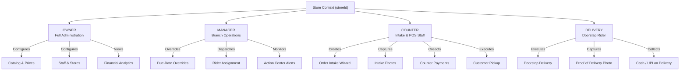

# 01. Project Overview & Business Domain

> **Module:** Domain Analysis, Personas & System Scope  
> **Source Location:** `apps/`, `packages/`, `prisma/schema.prisma`, `docs/`  
> **Status:** Fully Audited  

---

## 1. Domain Background & Problem Statement

The retail laundry and dry-cleaning industry is characterized by high transaction frequency, physical garment handling across multiple chemical and thermal processing stages, complex service-garment matrix pricing, and split customer interactions (intake at a counter, processing at a centralized plant, and delivery at customer homes).

### Core Operational Challenges:

1. **Piece-Level Tracking Failure**: An order of 5 shirts and 2 suits consists of 7 discrete physical articles that may be sorted into different treatment streams (e.g., wash & iron vs. chemical dry-cleaning). If tracking occurs only at the order header or line-item level, individual garments become separated, resulting in customer delivery discrepancies.
2. **Defect Liability Disputes**: Retail customers often claim that stains, tears, missing buttons, or fabric shine were caused by the cleaner. Without timestamped, immutable photographic evidence taken at intake, businesses incur significant financial losses in goodwill compensation.
3. **Connectivity Fragility**: Store locations in high-density urban areas frequently experience network drops. If counter POS terminals rely on synchronous online APIs, customer queues stall.
4. **Service Heterogeneity**:
   - **Dry Cleaning**: Billed per garment piece (e.g., Silk Saree, 2-Piece Suit, Blazer), requires solvent treatment, inspects for fabric delicacy, and has longer fulfillment windows (typically 3–4 days).
   - **Laundry (Wash & Fold / Wash & Iron)**: Billed per weight (kilograms) with minimum threshold constraints (e.g., 2.00 kg minimum to offset machine cycle costs), requiring fast turnaround (1–2 days).
   - **Express Processing**: Demands time-sensitive prioritization (Same-Day 2.0× multiplier, Next-Day Evening 1.5× multiplier) that must respect plant non-operating days (such as weekly plant maintenance on Thursdays).
5. **Cash and Multi-Mode Settlement Leakage**: Orders are frequently settled across multiple transactions: an advance at drop-off, a cash balance at pickup, or UPI via QR code at doorstep delivery. Without atomic idempotency and balance calculations, financial reconciliation fails.

---

## 2. User Personas & Access Roles

GrowFast implements strict Role-Based Access Control (RBAC) enforced server-side via NestJS guards. Four primary roles operate within the system:



### Detailed Persona Profiles:

| Persona | Role Enum | Primary Work Environment | Core Responsibilities |
|---|---|---|---|
| **Business Owner** | `OWNER` | Web Dashboard / Mobile | Strategic visibility, branch creation, master garment catalog and service pricing management, financial adjustment approval, employee lifecycle management. |
| **Store Manager** | `MANAGER` | Web Portal / Desktop | Operational throughput, action-center triage, customer due-date overrides with audit logging, rider dispatching, daily order reconciliation reports. |
| **Counter Staff** | `COUNTER` | Mobile POS / Web POS | Customer lookup and creation, multi-item order intake, defect tagging, intake photo capture, thermal tag generation, payment collection, customer pickup handovers. |
| **Delivery Rider** | `DELIVERY` | Mobile App | Route execution, customer home pickup/delivery, capturing proof-of-delivery photos, collecting cash-on-delivery (COD) or recording UPI reference IDs. |
| **Customer** | *(External)* | WhatsApp / SMS | Receives transactional notifications (Order Created, Ready for Pickup, Out for Delivery, Payment Receipt), views itemized digital bills with photo links. |

---

## 3. End-to-End Business Processes Supported

### Process 1: Counter Order Intake & Inspection
1. Counter staff searches customer by 10-digit mobile number or registers a new customer.
2. Selects workflow: **Laundry** (Wash & Fold, Wash & Iron) or **Dry Cleaning**.
3. Adds catalog items specifying service type, declared piece count, and weight (if weight-based laundry).
4. System validates rules:
   - Weight-based items must have weight $\ge 2.00\text{ kg}$.
   - Dry Cleaning is strictly per-piece (weight input is blocked).
5. Defect notes and color tags are recorded for fragile or stained garments.
6. Photos are attached for walk-in orders ($\le 50$ pieces require mandatory photos).
7. Express options (Same-Day or Next-Day Evening) apply calculated multipliers.
8. System derives due date based on `max(service.estimatedDays)` and adjusts for Thursday plant closures.
9. Staff saves locally as an offline draft or submits for instant server confirmation.
10. Server returns official sequential order number (e.g., `ORD-2026-000123`).

### Process 2: Physical Garment Tagging & Workshop Tracking
1. For every physical unit in an order line item, the system generates an immutable `PhysicalGarment` entity with a unique tag ID:
   $$\text{Tag ID Format: } \text{GF-XXXXXX} \quad (\text{e.g., } \text{GF-7K9M2P})$$
2. Web visual designer prints thermal tags (40×40 mm or 50×25 mm) with barcodes, customer initials, item sequence (e.g., `1/3`), and service indicator.
3. Workshop operators scan garments during washing, drying, pressing, and packaging stages.
4. When individual garments finish packaging, operators mark them `isReady = true`.
5. When all non-cancelled items reach `READY`, canonical order status automatically transitions from `PROCESSING` to `READY`.

### Process 3: Doorstep Pickup & Delivery Logistics
1. Manager schedules home delivery from the web portal, creating a `DeliveryRecord`.
2. Rider is assigned; system sends an automated WhatsApp message to the customer.
3. Order transitions to `OUT_FOR_DELIVERY` while rider is in transit.
4. At customer doorstep, rider verifies physical items, collects balance payment (CASH or UPI), takes a Proof-of-Delivery photo, and marks the delivery `COMPLETED`.
5. Order status transitions to `DELIVERED`.

### Process 4: Payment Settlement & Financial Reconciliation
1. Every payment is tracked as an immutable transaction ledger entry (`Payment` entity).
2. Supports partial payments, advance payments, and multiple payment methods (`CASH`, `UPI`, `CARD`, `ONLINE`, `STORE_CREDIT`).
3. Server recalculates `amountPaid` and `amountDue = totalAmount - amountPaid`.
4. Payment status updates deterministically:
   - $amountPaid = 0 \implies \text{PENDING}$
   - $0 < amountPaid < totalAmount \implies \text{PARTIAL}$
   - $amountPaid \ge totalAmount \implies \text{PAID}$
5. Client-generated `idempotencyKey` prevents duplicate transaction recording during network drops.

---

## 4. Platform & Implementation State

```
┌─────────────────────────────────────────────────────────────────────────┐
│                           GROWFAST MONOREPO                             │
├──────────────────────────┬──────────────────────────┬───────────────────┤
│    APPS/BACKEND (NestJS) │      APPS/WEB (React 19) │  APPS/MOBILE (RN) │
│  - REST Controllers      │  - Desktop Management    │  - Offline POS    │
│  - Auth & RolesGuard     │  - Order Intake Wizard   │  - SQLite Drafts  │
│  - Prisma ORM & Postgres │  - Analytics Dashboard   │  - Camera Intake  │
│  - Idempotency Layer     │  - Staff Admin & Catalog │  - Sync Engine    │
│  - S3 / R2 Cloud Storage │  - Tag Template Designer │  - Payment Modal  │
│  - WhatsApp Notification │  - Delivery Tracking     │  - LAN Discovery  │
├──────────────────────────┴──────────────────────────┴───────────────────┤
│                         PACKAGES/SHARED-TYPES                           │
│  - Enums (Role, OrderStatus, ItemStatus, PaymentMode, GarmentCategory)  │
│  - DTOs & Validation Contracts                                          │
│  - Canonical deriveOrderStatus() State Machine                          │
│  - calculateOrderTotals() & Express Multipliers                         │
└─────────────────────────────────────────────────────────────────────────┘
```

### System Implementation Matrix:

| Subsystem | Web Application | Mobile Application | Backend REST API | Database Schema |
|---|---|---|---|---|
| **Authentication** | Completed (`LoginPage`) | Completed (`login.tsx`, `AuthContext`) | Completed (`auth.module`) | Completed (`Employee`) |
| **Customer Management** | Completed (`HomePage`, `CustomerProfile`) | Completed (`CustomerStep`) | Completed (`customer.module`) | Completed (`Customer`) |
| **Catalog & Pricing** | Completed (`CatalogSettingsPage`) | Completed (`CatalogItemsStep`) | Completed (`catalog.module`) | Completed (`GarmentCatalog`, `ServiceGarmentPrice`) |
| **Order Intake** | Completed (`OrderWizardPage`) | Completed (`OrderWizardModal`) | Completed (`order.module`) | Completed (`Order`, `OrderItem`, `PhysicalGarment`) |
| **Photo Inspection** | Completed (`PhotoCaptureView`) | Completed (`RequirementsStep`) | Completed (`photo.module`) | Completed (`OrderPhoto`) |
| **Offline Sync** | N/A (Online Web) | Completed (`sync-engine.ts`, SQLite) | Completed (Idempotency API) | Completed (`[storeId, clientDraftId]`) |
| **Payment Collection** | Completed (`OrderDetailPage`) | Completed (`PaymentCollectionModal`) | Completed (`payment.module`) | Completed (`Payment`) |
| **Thermal Tag Design** | Completed (`TagDesignerPage`) | N/A (Uses server tags) | Completed (`store.module`) | Completed (`TagTemplate`) |
| **WhatsApp Messages** | N/A (Automated) | N/A (Automated) | Completed (`notification.module`) | Completed (`Notification`) |
| **Analytics & KPIs** | Completed (`DashboardPage`) | Basic Overview (`index.tsx`) | Completed (`dashboard.module`) | Aggregated Queries |
