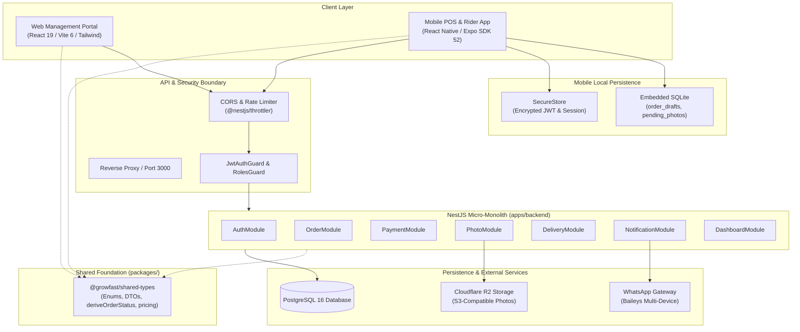
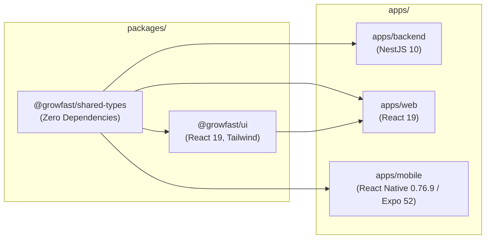
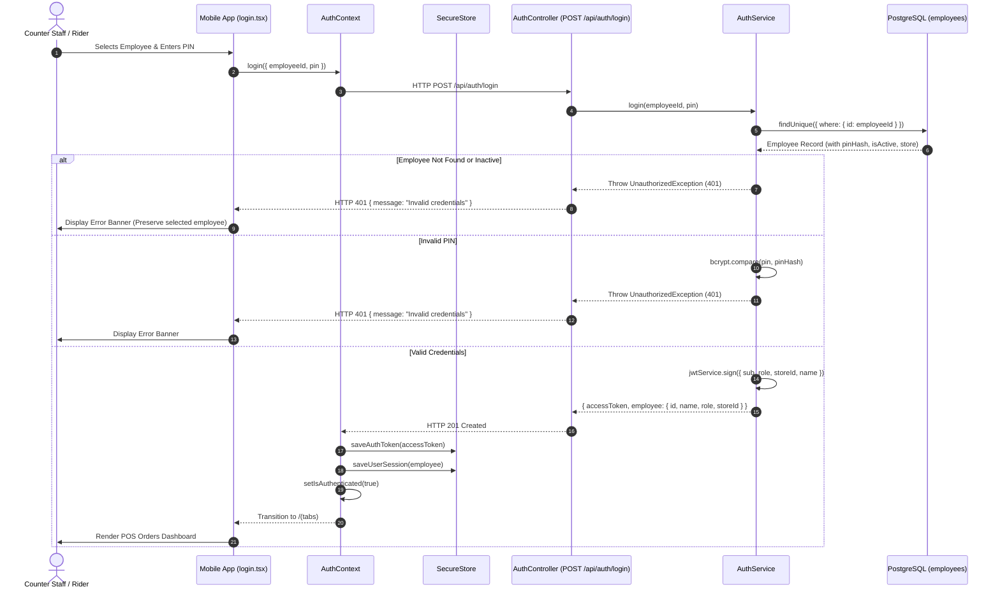
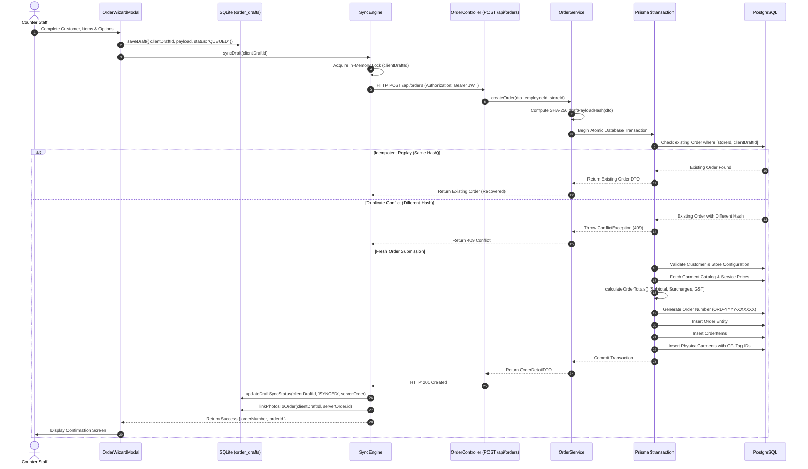
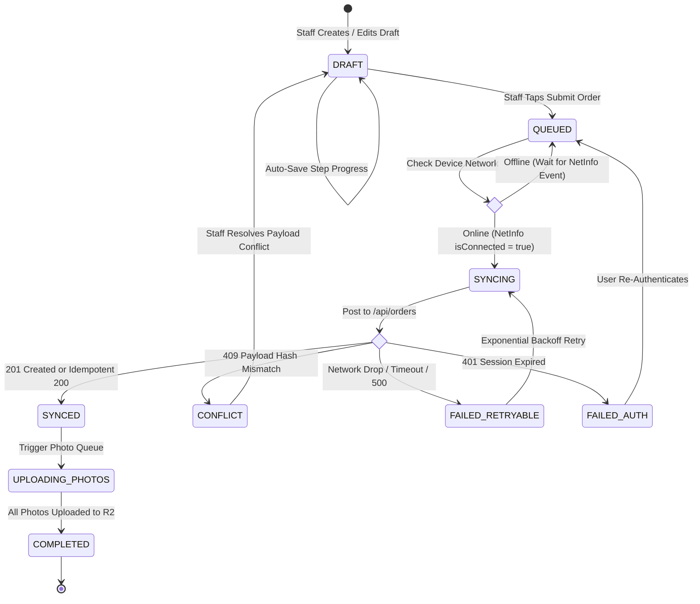
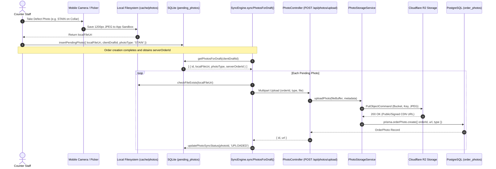
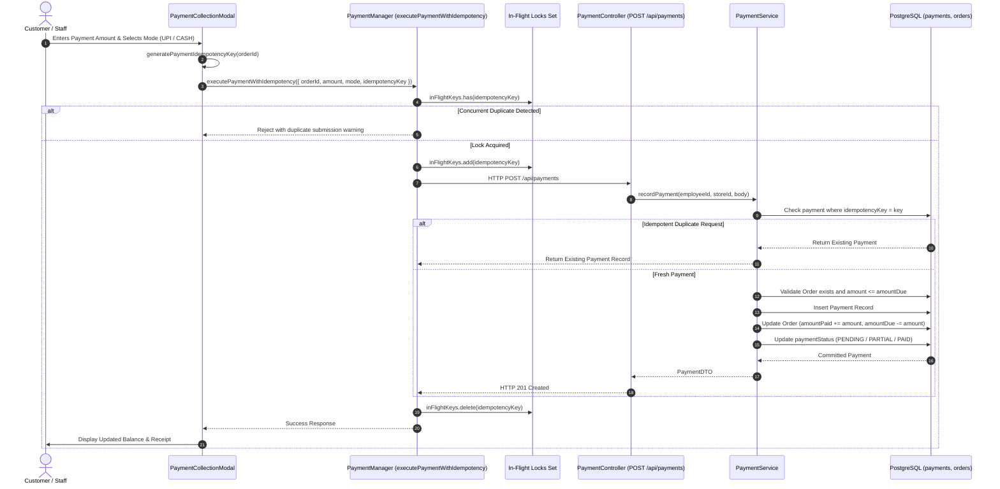
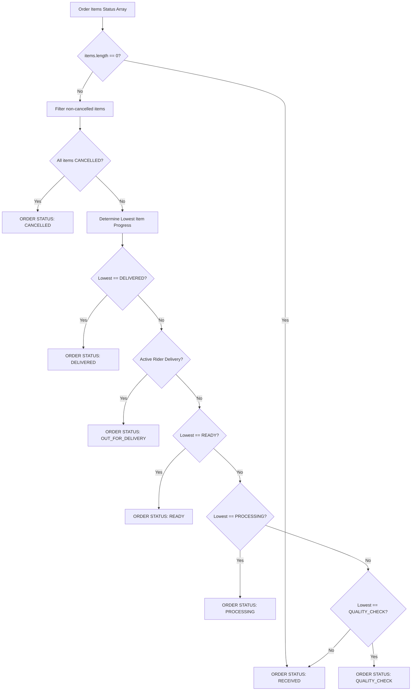

# 03. System Architecture & Data Flow

> **Module:** Architectural Topology, Request Lifecycles & State Transitions  
> **Source Location:** `apps/`, `packages/`, `prisma/`  
> **Status:** Fully Audited & Diagrammed

---

## 1. High-Level Architectural Topology

GrowFast is designed as a distributed, multi-client system centered on a NestJS micro-monolith backend backed by a PostgreSQL relational database.

---

## 2. Monorepo Package Relationships

---

## 3. Authentication & Login Flow

Authentication uses employee identifiers with 4-to-6 digit numeric PINs. PINs are verified via bcryptjs hashes, and upon success, a signed JWT access token is returned.

---

## 4. Order Creation & Confirmation Pipeline

Order creation guarantees **100% server-enforced idempotency**. Submitting a duplicate `clientDraftId` with the identical payload returns the previously created order; submitting a mismatched payload under the same draft ID returns HTTP 409 Conflict.

---

## 5. Offline Draft Synchronization State Machine

---

## 6. Photo Capture & Storage Pipeline

Garment intake photos are stored locally on the mobile filesystem before being asynchronously synchronized to Cloudflare R2 / AWS S3:

---

## 7. Payment Processing & Idempotency Pipeline

---

## 8. Canonical Order Status Derivation Pipeline

Order status is **never** manually set. It is derived through the deterministic state machine in `@growfast/shared-types`:

