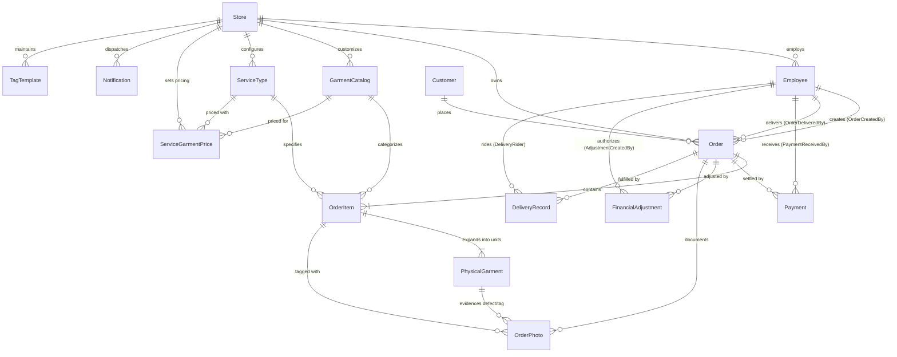

# 04 — Database & Data Model Specification

## 1. Overview & Architecture

The GrowFast data persistence architecture is divided into two distinct, coordinated tiers:

1. **Authoritative Server Database**: PostgreSQL 16 managed via Prisma ORM 5.20.0 (`apps/backend/` and `prisma/schema.prisma`). It enforces relational integrity, foreign key cascades, tenant boundaries, composite unique constraints, financial ledger consistency, and sequential business numbering.
2. **Transient Mobile Edge Database**: SQLite managed via `expo-sqlite` 15.1.4 with a custom transactional migration runner (`apps/mobile/src/db/sqlite.ts`). It handles offline order staging, draft queues, retry backoff tracking, local photo disk mapping, and optimistic order draft creation.

---

## 2. Server Data Model (Prisma / PostgreSQL)

### 2.1 Entity Relationship Diagram (Mermaid ERD)



---

### 2.2 Model Specifications & Schema Attributes

The schema defines **16 relational models** and **17 enumerated types**.

#### 1. `Store` (`stores`)

Tenant boundary for multi-branch operations.

- `id` (String, PK, cuid)
- `name` (String)
- `address`, `phone` (String, nullable)
- `isActive` (Boolean, default: true)
- `expressSurchargePercent` (Float, nullable): Store-level express markup percentage.
- `topUpServices` (Json, nullable): Dynamic add-on configurations (starching, antiseptic, stain removal).
- `createdAt`, `updatedAt` (DateTime)

#### 2. `Employee` (`employees`)

Staff members and operators authenticated via PIN.

- `id` (String, PK, cuid)
- `name` (String)
- `phone` (String, nullable)
- `email` (String, unique, nullable)
- `pinHash` (String, `@map("pin_hash")`): bcrypt hashed 4–6 digit security PIN.
- `role` (Role enum: `OWNER`, `MANAGER`, `COUNTER`, `DELIVERY`)
- `storeId` (String, FK -> `stores.id`)
- `isActive` (Boolean, default: true)
- **Indexes**: `@@index([storeId])`, `@@index([role])`, `@@index([isActive])`

#### 3. `Customer` (`customers`)

Master directory of laundry patrons.

- `id` (String, PK, cuid)
- `name` (String)
- `phone` (String, unique): Primary lookup and WhatsApp messaging key.
- `email`, `address`, `pincode` (String, nullable)
- `customerCode` (String, unique, nullable, e.g. `GF-C-0001`)
- `membership` (MembershipTier enum: `NONE`, `SILVER`, `GOLD`, `PLATINUM`, default: `NONE`)
- `discountPercent` (Float, default: 0)
- `preferences` (Json, nullable): Fragrance preference, heavy/light starch, folding vs hanger instructions.
- `registrationSource` (String, default: "WALK_IN")
- **Indexes**: `@@index([customerCode])`, `@@index([phone])`, `@@index([name])`

#### 4. `GarmentCatalog` (`garment_catalog`)

Master list of washable articles and items.

- `id` (String, PK, cuid)
- `name` (String, e.g., "Men Shirt", "Silk Saree", "Double Blanket")
- `category` (GarmentCategory enum: `MEN`, `WOMEN`, `KIDS`, `HOUSEHOLD`, `SHOES`, `SPECIAL`, `WEIGHT_BASED`, `OTHERS`, `HOME_CLEANING`)
- `section` (String, nullable)
- `isActive` (Boolean, default: true)
- `storeId` (String, FK -> `stores.id`, nullable for global defaults)
- **Indexes**: `@@index([category])`, `@@index([storeId])`

#### 5. `ServiceType` (`service_types`)

Processing treatments available for garments.

- `id` (String, PK, cuid)
- `name` (String, e.g., "Steam Press", "Dry Cleaning", "Wash & Fold")
- `category` (ServiceCategory enum: `DRY_CLEAN`, `STEAM_PRESS`, `WASH`, `WASH_IRON`, `SHOE_CLEAN`, `LEATHER_CLEAN`, `STAIN_REMOVAL`, `WEIGHT_BASED`)
- `estimatedDays` (Int, default: 2): SLA turnaround days used to compute initial due date.
- `isActive` (Boolean, default: true)
- `storeId` (String, FK -> `stores.id`, nullable)
- **Indexes**: `@@index([category])`, `@@index([storeId])`

#### 6. `ServiceGarmentPrice` (`service_garment_prices`)

The pricing matrix resolving `GarmentCatalog × ServiceType × Store`.

- `id` (String, PK, cuid)
- `garmentCatalogId` (String, FK -> `garment_catalog.id`, onDelete: Cascade)
- `serviceTypeId` (String, FK -> `service_types.id`, onDelete: Cascade)
- `price` (Float): Base unit price or per-kg price.
- `storeId` (String, FK -> `stores.id`, nullable)
- **Constraints**: `@@unique([garmentCatalogId, serviceTypeId, storeId])`
- **Indexes**: `@@index([garmentCatalogId])`, `@@index([serviceTypeId])`, `@@index([storeId])`

#### 7. `Order` (`orders`)

The central business document of the system.

- `id` (String, PK, cuid)
- `orderNumber` (String, unique): Formatted identifier (e.g., `ORD-20261023-0001`).
- `customerId` (String, FK -> `customers.id`)
- `orderDate` (DateTime, default: now)
- `systemDueDate` (DateTime): SLA-calculated completion target.
- `effectiveDueDate` (DateTime): Working due date (accounts for Thursday off and manual overrides).
- `dueDateOverrideReason`, `dueDateOverriddenBy` (String, nullable)
- `isExpress` (Boolean, default: false)
- `expressDeliveryOption` (String, nullable: e.g. "SAME_DAY_2X", "NEXT_DAY_1_5X")
- `serviceSummary` (String, nullable)
- `status` (OrderStatus enum: `RECEIVED`, `SORTING`, `PROCESSING`, `DRYING`, `IRONING`, `QUALITY_CHECK`, `PACKED`, `READY`, `OUT_FOR_DELIVERY`, `DELIVERED`, `CANCELLED`, default: `RECEIVED`)
- `subtotal` (Float, default: 0)
- `discountAmount` (Float, default: 0)
- `expressSurcharge` (Float, default: 0)
- `taxAmount` (Float, default: 0): 18% GST component.
- `totalAmount` (Float, default: 0)
- `amountPaid` (Float, default: 0)
- `amountDue` (Float, default: 0)
- `paymentStatus` (PaymentStatus enum: `PENDING`, `PARTIAL`, `PAID`, `REFUNDED`, default: `PENDING`)
- `pickupType` (PickupType enum: `STORE_PICKUP`, `HOME_DELIVERY`, default: `STORE_PICKUP`)
- `priority` (OrderPriority enum: `STANDARD`, `EXPRESS`, `VIP`, default: `STANDARD`)
- `notes` (String, nullable)
- `syncStatus` (SyncStatus enum: `SYNCED`, `PENDING`, `FAILED`, default: `SYNCED`)
- `clientDraftId` (String, nullable): Idempotency key from mobile client UUID.
- `draftPayloadHash` (String, nullable): SHA-256 hash of line items for idempotency verification.
- `createdById` (String, FK -> `employees.id`)
- `deliveredById` (String, FK -> `employees.id`, nullable)
- `deliveredAt` (DateTime, nullable)
- `storeId` (String, FK -> `stores.id`)
- **Constraints**: `@@unique([storeId, clientDraftId])`
- **Indexes**: `@@index([customerId])`, `@@index([status])`, `@@index([paymentStatus])`, `@@index([orderDate])`, `@@index([storeId])`, `@@index([createdById])`, `@@index([deliveredById])`

#### 8. `OrderItem` (`order_items`)

Line item grouping inside an order.

- `id` (String, PK, cuid)
- `orderId` (String, FK -> `orders.id`, onDelete: Cascade)
- `garmentCatalogId` (String, FK -> `garment_catalog.id`)
- `serviceTypeId` (String, FK -> `service_types.id`)
- `quantity` (Int, default: 1)
- `weight` (Float, nullable): Measured weight in kg (for laundry-by-weight).
- `unitPrice` (Float)
- `lineTotal` (Float)
- `colorTags` (String[], default: [])
- `defectNotes` (String, nullable)
- `itemStatus` (ItemStatus enum: `RECEIVED`, `PROCESSING`, `QUALITY_CHECK`, `READY`, `DELIVERED`, `CANCELLED`, default: `RECEIVED`)
- `deliveredQuantity` (Int, default: 0)
- `itemDueDate` (DateTime, nullable)
- **Indexes**: `@@index([orderId])`, `@@index([itemStatus])`

#### 9. `PhysicalGarment` (`physical_garments`)

Individual garment unit tracking (e.g. 5 shirts expand into 5 physical garment rows).

- `id` (String, PK, cuid)
- `orderItemId` (String, FK -> `order_items.id`, onDelete: Cascade)
- `unitNumber` (Int): 1-indexed count within line item (`1, 2, ..., quantity`).
- `tagId` (String, unique, nullable, format: `GF-XXXXXX` barcode/QR identifier).
- `isReady` (Boolean, default: false)
- `isCancelled` (Boolean, default: false)
- `isDelivered` (Boolean, default: false)
- `deliveredAt` (DateTime, nullable)
- **Constraints**: `@@unique([orderItemId, unitNumber])`, `@unique tagId`
- **Indexes**: `@@index([orderItemId])`, `@@index([tagId])`

#### 10. `OrderPhoto` (`order_photos`)

Visual documentation of garment conditions, defects, tags, and delivery proof.

- `id` (String, PK, cuid)
- `orderId` (String, FK -> `orders.id`, onDelete: Cascade)
- `orderItemId` (String, FK -> `order_items.id`, onDelete: SetNull, nullable)
- `physicalGarmentId` (String, FK -> `physical_garments.id`, onDelete: SetNull, nullable)
- `type` (PhotoType enum: `FRONT`, `BACK`, `DAMAGE`, `STAIN`, `TAG`, `DELIVERY_PROOF`)
- `url` (String): Cloudflare R2 / S3 public URL or object key.
- `uploadedAt` (DateTime, default: now)
- **Indexes**: `@@index([orderId])`, `@@index([orderItemId])`, `@@index([physicalGarmentId])`

#### 11. `Payment` (`payments`)

Financial transaction ledger for order settlements.

- `id` (String, PK, cuid)
- `orderId` (String, FK -> `orders.id`, onDelete: Cascade)
- `amount` (Float): Tendered currency amount.
- `mode` (PaymentMode enum: `CASH`, `UPI`, `CARD`, `ONLINE`, `STORE_CREDIT`)
- `reference` (String, nullable: e.g. UPI transaction ID, bank RRN).
- `idempotencyKey` (String, unique, nullable): Client UUID preventing duplicate charge submissions.
- `receivedById` (String, FK -> `employees.id`)
- `createdAt` (DateTime, default: now)
- **Indexes**: `@@index([orderId])`

#### 12. `FinancialAdjustment` (`financial_adjustments`)

Compensations, credit notes, and post-order refunds.

- `id` (String, PK, cuid)
- `orderId` (String, FK -> `orders.id`, onDelete: Cascade)
- `type` (AdjustmentType enum: `REFUND`, `STORE_CREDIT`)
- `amount` (Float)
- `reason` (String)
- `status` (AdjustmentStatus enum: `COMPLETED`, `VOIDED`, default: `COMPLETED`)
- `reference` (String, nullable)
- `createdById` (String, FK -> `employees.id`)
- **Indexes**: `@@index([orderId])`, `@@index([createdById])`

#### 13. `DeliveryRecord` (`delivery_records`)

Logistics dispatch tracking for home deliveries.

- `id` (String, PK, cuid)
- `orderId` (String, FK -> `orders.id`, onDelete: Cascade)
- `address` (String)
- `riderId` (String, FK -> `employees.id`, nullable)
- `status` (DeliveryStatus enum: `SCHEDULED`, `ASSIGNED`, `IN_TRANSIT`, `COMPLETED`, `FAILED`, default: `SCHEDULED`)
- `scheduledAt`, `completedAt` (DateTime, nullable)
- `proofPhotoUrl` (String, nullable)
- `notes` (String, nullable)
- **Indexes**: `@@index([orderId])`, `@@index([riderId])`, `@@index([status])`

#### 14. `Notification` (`notifications`)

Transactional customer message audit log.

- `id` (String, PK, cuid)
- `storeId` (String, FK -> `stores.id`)
- `orderId`, `customerId` (String, nullable)
- `eventType` (NotificationEventType enum: `ORDER_CREATED`, `ORDER_READY`, `ORDER_OUT_FOR_DELIVERY`, `ORDER_DELIVERED`, `PAYMENT_RECEIVED`)
- `channel` (NotificationChannel enum: `SMS`, `WHATSAPP`, `EMAIL`, `IN_APP`)
- `status` (NotificationStatus enum: `CREATED`, `QUEUED`, `SENT`, `FAILED`, default: `CREATED`)
- `recipient` (String: phone number or email)
- `payload` (Json, nullable)
- `sentAt`, `failedAt` (DateTime, nullable)
- `failureReason` (String, nullable)
- `retryCount` (Int, default: 0)
- **Indexes**: `@@index([storeId])`, `@@index([orderId])`, `@@index([eventType])`, `@@index([status])`

#### 15. `TagTemplate` (`tag_templates`)

Thermal printer format layout specifications (40×40 mm garment labels).

- `id` (String, PK, cuid)
- `storeId` (String, FK -> `stores.id`, onDelete: Cascade)
- `name` (String, default: "Default 40x40 mm Tag")
- `version` (Int, default: 1)
- `layout` (Json): Dimensions, barcode placement, font sizes, QR specifications.
- `isActive` (Boolean, default: true)
- **Indexes**: `@@index([storeId])`, `@@index([storeId, isActive])`

#### 16. `BusinessSequence` (`business_sequences`)

Atomic sequence counter for generating human-readable identifiers (`GF-XXXXXX`, `ORD-YYYYMMDD-XXXX`).

- `name` (String, PK, e.g. "order_number_seq", "tag_id_seq")
- `currentVal` (Int, default: 0)
- `updatedAt` (DateTime)

---

## 3. Mobile Edge Data Model (SQLite)

Implemented in `apps/mobile/src/db/sqlite.ts` utilizing `expo-sqlite` 15.1.4:

### 3.1 SQLite Tables

#### `schema_migrations`

Tracks applied migration steps on the physical device.

```sql
CREATE TABLE IF NOT EXISTS schema_migrations (
  version INTEGER PRIMARY KEY,
  name TEXT NOT NULL,
  applied_at TEXT NOT NULL
);
```

#### `order_drafts`

Staged order payloads created when mobile devices are offline.

```sql
CREATE TABLE IF NOT EXISTS order_drafts (
  id TEXT PRIMARY KEY,
  client_draft_id TEXT UNIQUE NOT NULL,
  store_id TEXT NOT NULL,
  customer_id TEXT,
  customer_name TEXT,
  customer_phone TEXT,
  payload_json TEXT NOT NULL,
  sync_status TEXT NOT NULL DEFAULT 'DRAFT', -- DRAFT, PENDING_SYNC, SYNCED, FAILED
  created_at TEXT NOT NULL,
  updated_at TEXT NOT NULL,
  server_order_id TEXT,
  server_order_number TEXT,
  retry_count INTEGER NOT NULL DEFAULT 0,
  last_sync_attempt_at TEXT,
  last_error TEXT,
  conflict_details TEXT,
  workflow_type TEXT,
  pickup_type TEXT DEFAULT 'STORE_PICKUP',
  is_express INTEGER NOT NULL DEFAULT 0,
  notes TEXT
);
CREATE INDEX IF NOT EXISTS idx_order_drafts_store ON order_drafts(store_id);
CREATE INDEX IF NOT EXISTS idx_order_drafts_sync ON order_drafts(sync_status);
CREATE INDEX IF NOT EXISTS idx_order_drafts_server_order ON order_drafts(server_order_id);
```

#### `pending_photos`

Staged camera image files stored on native disk pending Cloudflare R2 upload.

```sql
CREATE TABLE IF NOT EXISTS pending_photos (
  id TEXT PRIMARY KEY,
  client_draft_id TEXT NOT NULL,
  garment_id TEXT,
  unit_number INTEGER,
  local_file_uri TEXT NOT NULL,
  photo_type TEXT NOT NULL DEFAULT 'FRONT',
  sync_status TEXT NOT NULL DEFAULT 'PENDING',
  created_at TEXT NOT NULL,
  server_photo_id TEXT,
  server_order_id TEXT,
  retry_count INTEGER NOT NULL DEFAULT 0,
  last_error TEXT,
  file_size INTEGER,
  mime_type TEXT,
  updated_at TEXT,
  FOREIGN KEY (client_draft_id) REFERENCES order_drafts(client_draft_id) ON DELETE CASCADE
);
CREATE INDEX IF NOT EXISTS idx_pending_photos_draft ON pending_photos(client_draft_id);
CREATE INDEX IF NOT EXISTS idx_pending_photos_server_order ON pending_photos(server_order_id);
```

---

## 4. State Authority & Data Lifecycle Comparison

| Attribute                | PostgreSQL (Server Authority)                     | SQLite (Mobile Edge)                              |
| :----------------------- | :------------------------------------------------ | :------------------------------------------------ |
| **Persistence Duration** | Permanent, audit-trailed, backed up               | Ephemeral / Staging until confirmed sync          |
| **Financial Ledger**     | Strictly authoritative, unit-tested, GST audited  | Preview calculations only; reconciles with server |
| **Order Status**         | Canonical derived via `deriveOrderStatus()`       | Cached mirror from server response                |
| **Order Number**         | Canonical `ORD-YYYYMMDD-XXXX`                     | Temporary client draft UUID (`clientDraftId`)     |
| **Photos**               | Cloudflare R2 public CDN URLs                     | `file:///...` native cache storage                |
| **Garment Tags**         | Canonical `GF-XXXXXX` generated in DB transaction | Null or pending tag placeholder                   |
| **Payment Records**      | Enforced unique `idempotencyKey`                  | Staged payment payload                            |

---

## 5. Migration Strategy & Evolution

1. **Backend Database Migrations**:
   - Maintained under `prisma/migrations/`.
   - Executed via `npm run db:migrate` (`prisma migrate deploy` or `prisma migrate dev`).
   - Schema lock: Strictly governed by Rule 17 & Rule 18 in `AGENTS.md` (single developer ownership to prevent competing migration conflicts).
2. **Mobile Database Migrations**:
   - Sequential version-gated migrations inside `apps/mobile/src/db/sqlite.ts` (`MIGRATIONS: Migration[]`).
   - Idempotent table creation and safe schema evolution using `ALTER TABLE ... ADD COLUMN` inside try/catch blocks.
   - Run automatically on app boot during `getDatabase()` initialization.
