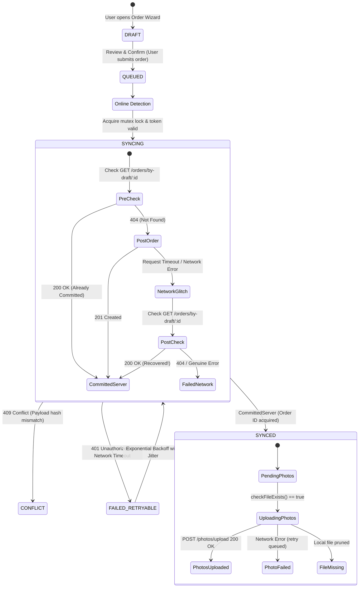

# 08 — Mobile Offline-First Architecture & Sync Engine

## 1. Architectural Philosophy: Offline-First Reliability

The GrowFast mobile application (`apps/mobile`) operates as a mission-critical Counter & Driver POS. In suburban and industrial commercial laundry environments, Wi-Fi and 4G connectivity frequently drop. An operator cannot be blocked from intake tagging, billing, or photographing clothes simply because internet access is temporarily lost.

The mobile app implements an **offline-first, optimistic staging pattern**:
1. All order creations and photo captures write immediately to local device SQLite storage.
2. Orders can be completed offline, generating a local stable UUID (`clientDraftId`).
3. When network connectivity is active, an autonomous background synchronization engine (`SyncEngine`) flushes queued orders and associated images to the backend with idempotency, exponential backoff, and post-timeout recovery.

---

## 2. Local Database Schema & Draft Lifecycle

Source: `apps/mobile/src/db/sqlite.ts` & `apps/mobile/src/db/drafts.ts`

### 2.1 SQLite Schema & Models
The local database `growfast_mobile.db` contains two primary staging tables:

1. **`order_drafts`**:
   - `client_draft_id` (TEXT UNIQUE NOT NULL): UUIDv4 generated at order creation.
   - `store_id` (TEXT NOT NULL): Branch tenant context.
   - `customer_id`, `customer_name`, `customer_phone` (TEXT)
   - `payload_json` (TEXT NOT NULL): Serialized `CreateOrderDto`.
   - `sync_status` (TEXT NOT NULL): `DRAFT`, `QUEUED`, `SYNCING`, `SYNCED`, `FAILED_RETRYABLE`, `CONFLICT`.
   - `server_order_id`, `server_order_number` (TEXT, populated upon sync).
   - `retry_count` (INTEGER DEFAULT 0).
   - `last_sync_attempt_at`, `last_error`, `conflict_details` (TEXT).

2. **`pending_photos`**:
   - `id` (TEXT PRIMARY KEY)
   - `client_draft_id` (TEXT FK -> `order_drafts.client_draft_id` ON DELETE CASCADE)
   - `local_file_uri` (TEXT NOT NULL): Native device file path (`file:///data/user/0/...`).
   - `photo_type` (TEXT: `FRONT`, `BACK`, `DAMAGE`, `STAIN`, `DELIVERY_PROOF`).
   - `sync_status` (TEXT: `PENDING`, `UPLOADING`, `UPLOADED`, `FAILED`, `FILE_MISSING`).
   - `server_photo_id`, `server_order_id` (TEXT).
   - `file_size`, `mime_type` (INTEGER, TEXT).

---

## 3. Synchronization State Machine & Transitions



---

## 4. Key Engineering Mechanisms in `SyncEngine`

Source: `apps/mobile/src/services/sync-engine.ts`

### 4.1 Mutex Concurrency Locks
To prevent parallel sync loops from submitting the same draft twice when the user taps "Retry" or when network reconnect fires simultaneously:
```typescript
private activeLocks = new Set<string>();
// In syncDraft():
if (this.activeLocks.has(clientDraftId)) {
  return { success: false, error: 'Draft is already being synchronized' };
}
this.activeLocks.add(clientDraftId);
```

### 4.2 Two-Phase Idempotency Recovery Pattern
A notorious failure mode in mobile REST architectures is **Timeout After Server Commit**:
1. Mobile sends `POST /orders`.
2. Backend receives request, opens database transaction, commits order to PostgreSQL, and begins serializing the response.
3. Cellular tower drops connection or client HTTP socket times out after 15 seconds.
4. Mobile client assumes request failed.

**GrowFast's Solution**:
- **Phase 1 (Pre-Check)**: Before sending `POST /orders`, `SyncEngine` queries `GET /orders/by-draft/:draftId`. If found, it recovers the server order immediately without issuing a write.
- **Phase 2 (Post-Timeout Probe)**: If `POST /orders` throws a network or timeout error, instead of immediately marking the draft failed, `SyncEngine` makes an emergency probe to `GET /orders/by-draft/:draftId`. If the server acknowledges the record exists, the draft is marked `SYNCED` and flagged as `recovered: true`.

### 4.3 Bounded Exponential Backoff with Random Jitter
```typescript
public calculateBackoff(attempt: number): number {
  const exponential = this.baseDelayMs * Math.pow(2, Math.max(0, attempt));
  const capped = Math.min(this.maxDelayMs, exponential); // Max 60,000 ms (1 minute)
  const jitter = Math.floor(Math.random() * 500);          // + 0..500 ms jitter
  return capped + jitter;
}
```
This prevents the "thundering herd" problem when dozens of POS devices reconnect to a restored shop Wi-Fi network at the exact same second.

### 4.4 Local Photo File Verification (`checkFileExists`)
Before attempting to upload binary photo data to Cloudflare R2, the engine checks `FileSystem.getInfoAsync(photo.localFileUri)`. If the Android OS pruned the temporary camera cache, the engine transitions the record to `FILE_MISSING` and logs an auditable diagnostic rather than throwing endless network 500 errors.

---

## 5. Offline Capabilities vs Server Constraints

| Capability | Offline Mode Behavior | Online Mode Behavior |
| :--- | :--- | :--- |
| **Customer Search** | Searches cached customers in query cache | Live fuzzy search across database |
| **New Customer Creation** | Staged in draft JSON payload | Created in PostgreSQL immediately |
| **Order Creation** | Saved to local SQLite `order_drafts` with UUID | Directly committed to PostgreSQL |
| **Pricing Calculation** | Accurate preview via `calculateOrderTotals()` | Server validates & re-derives totals |
| **Physical Garment Tagging**| Pre-allocated local placeholders | Canonical `GF-XXXXXX` generated by backend sequence |
| **Photo Capture** | Saved to native camera filesystem cache | Streamed to Cloudflare R2 CDN |
| **Payment Collection** | Staged with UUID `idempotencyKey` | Settled in DB ledger with real-time balance update |
| **Status Progression** | Read-only from last fetched snapshot | Canonical derived via `deriveOrderStatus()` |
