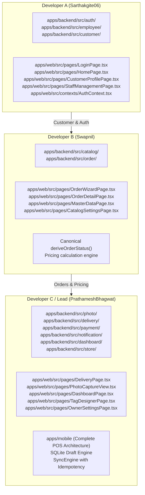

# 13 — Team Structure, Roles & Verified Individual Contributions

## 1. Governance & Team Ownership Boundaries

The GrowFast project was engineered by a three-person engineering team with strictly divided domain boundaries codified in `AGENTS.md`. This separation of concerns prevented merge collisions, ensured accountability, and localized architectural side effects.

### Team Responsibility Matrix

---

## 2. Git History Audit & Verified Author Statistics

Source: `git shortlog -sn --all` (Total: 183 commits)

| Engineer               | Git Identifier                                | Commit Count | Primary Ownership Areas                              | Verified Core Contributions                                                                                                                                                                                                                                                           |
| :--------------------- | :-------------------------------------------- | :----------: | :--------------------------------------------------- | :------------------------------------------------------------------------------------------------------------------------------------------------------------------------------------------------------------------------------------------------------------------------------------ |
| **Prathamesh Bhagwat** | `PrathameshBhagwat <bhagvatprathu@gmail.com>` |   **126**    | Developer C / Architecture Lead / Mobile Engineering | Monorepo architecture, Cloudflare R2 media storage, WhatsApp Baileys notifications, payment ledger & idempotency, delivery logistics, real-time analytics dashboard, thermal tag designer, Expo SDK 52 mobile POS, SQLite offline sync engine, and physical Android LAN verification. |
| **Swapnil**            | `Swapnil <swapnilofficial08@gmail.com>`       |    **41**    | Developer B / Order & Catalog Domain Lead            | Garment catalog matrices, 5-step order creation wizard (`OrderWizardPage.tsx`), per-piece vs weight-based workflows, 18% GST and express multiplier pricing, and canonical `deriveOrderStatus()` state machine.                                                                       |
| **Sarthak Gite**       | `Sarthakgite06 <sarthakgite006@gmail.com>`    |    **16**    | Developer A / Identity & Customer Specialist         | PIN authentication with bcryptjs and JWT, employee directory picker, customer search, walk-in customer registration, customer profiles, and staff role management.                                                                                                                    |

---

## 3. Detailed Contributions by Role

### 3.1 Developer A — Sarthak Gite

- **Backend Modules**:
  - `apps/backend/src/auth/`: Built PIN comparison logic using `bcryptjs`, JWT payload signing, and `@Throttle` rate limiting.
  - `apps/backend/src/employee/`: Built employee CRUD, role filtering (`OWNER`, `MANAGER`, `COUNTER`, `DELIVERY`), and soft-deletion flags.
  - `apps/backend/src/customer/`: Built phone-indexed customer lookup (`GET /api/customers/search?q=...`), registration, and order ledger history.
- **Frontend Pages**:
  - `LoginPage.tsx`: Touch-friendly employee card directory selector and numeric keypad PIN dialog.
  - `HomePage.tsx`: Fast customer search interface with debounced typing.
  - `CustomerProfilePage.tsx`: Customer profile view displaying lifetime spend, outstanding due balances, and preference notes.
  - `StaffManagementPage.tsx`: Staff directory and credential management for Owners and Managers.

### 3.2 Developer B — Swapnil

- **Backend Modules**:
  - `apps/backend/src/catalog/`: Built catalog category filters, service type SLA definitions, and `ServiceGarmentPrice` matrix endpoints.
  - `apps/backend/src/order/`: Built order creation pipeline, line item breakdown, physical garment tagging transactions, and due date calculators.
- **Domain Business Logic (`@growfast/shared-types`)**:
  - Authored canonical `deriveOrderStatus()` state machine enforcing lowest-index item precedence.
  - Authored `calculateOrderTotals()` incorporating 18% GST, Same-Day (2.0×) and Next-Day (1.5×) express multipliers, and minimum 2.00 kg weight rules.
  - Authored `adjustDueDateForThursday()` to automatically rollover Thursday completion targets.
- **Frontend Pages**:
  - `OrderWizardPage.tsx`: Built the comprehensive 5-step desktop stepper wizard for counter order intake.
  - `OrderDetailPage.tsx`: Detailed order tracker with status progress bar, item list, and partial pickup handler.
  - `CatalogSettingsPage.tsx` & `MasterDataPage.tsx`: Management tables for garments and service prices.

### 3.3 Developer C / Lead — Prathamesh Bhagwat

- **Backend Modules**:
  - `apps/backend/src/payment/`: Built payment collection engine with enforced `idempotencyKey`, multi-mode tender (`CASH`, `UPI`, `CARD`), and manager financial adjustments (`FinancialAdjustment`).
  - `apps/backend/src/photo/`: Built presigned Cloudflare R2 / S3 storage pipeline with local disk fallback for air-gapped setups.
  - `apps/backend/src/notification/`: Built headless PDF receipt generator (PDFKit) and Baileys WhatsApp automated notification dispatcher.
  - `apps/backend/src/delivery/`: Built logistics dispatch management, rider assignments, and proof-of-delivery photo validation.
  - `apps/backend/src/dashboard/` & `src/report/`: Built real-time revenue KPIs, collections reconciliation, and daily orders audit reporting.
  - `apps/backend/src/store/`: Built 40×40 mm thermal tag template configuration engine for TSC TE244 printers.
- **Frontend & Admin Tools**:
  - `TagDesignerPage.tsx`: Interactive drag-and-drop thermal label designer.
  - `DashboardPage.tsx`: Operational analytics dashboard with chart controls and Action Center queues.
  - `DeliveryPage.tsx`: Delivery rider dispatch board.
  - `PhotoCaptureView.tsx`: Web camera capture component for order intake photos.
- **Mobile POS & Offline Architecture (`apps/mobile`)**:
  - Configured Expo SDK 52, React Native 0.76.9, and Expo Router ~4.0.0.
  - Implemented SQLite draft storage (`order_drafts`, `pending_photos`) with transactional schema migrations.
  - Built `SyncEngine` featuring mutex concurrency locks, bounded exponential backoff with jitter, and post-timeout recovery (`getByDraftId`).
  - Solved cross-platform monorepo module resolution (React 19 vs React 18) and Windows LAN physical device connectivity (`192.168.1.38`).

---

## 4. Cross-Team Integration & Shared Governance

### 4.1 Shared Code Governance (Rules 14–19)

- `prisma/schema.prisma` was coordinated centrally under Developer C / Lead to ensure zero competing migration files.
- `packages/shared-types` served as the single source of truth; any change to DTOs or enums required PR review across all three developers.
- `packages/ui` provided standardized React 19 web primitives (`Button`, `Card`, `StatusChip`) to maintain visual consistency across Developer A, B, and C web pages.
