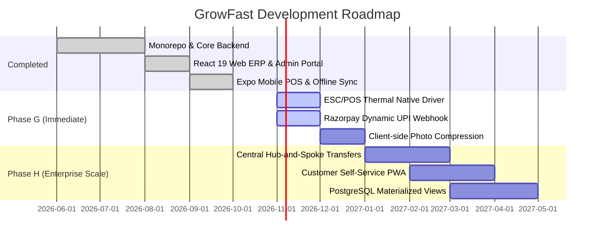

# 16 — Architectural Gaps, Technical Debt & Engineering Roadmap

## 1. Overview & Audit Intent

In accordance with the evidence-based standards of this project audit, this document explicitly separates verified capabilities from engineering gaps, known technical debt, and future roadmap objectives.

---

## 2. Technical Debt & Architectural Gaps

### 2.1 Hardware ESC/POS Printing Integration

- **Current State**: The web application features an interactive 40×40 mm thermal label designer (`TagDesignerPage.tsx`), and the backend provides template persistence (`TagTemplate` model).
- **Gap**: The system lacks an active ESC/POS or TSPL thermal printer communication driver (e.g. via WebUSB, Bluetooth SPP, or raw socket TCP/IP). Printing currently relies on browser standard print dialogs rather than direct thermal byte streaming to Zebra or TSC TE244 hardware.
- **Remediation**: Develop a dedicated lightweight printer agent (WebSocket service) or integrate a React Native Bluetooth ESC/POS library in `apps/mobile`.

### 2.2 Payment Gateway Webhook Integration

- **Current State**: The internal financial ledger (`Payment` model, `idempotencyKey`, partial fulfillment breakdown) is fully implemented and tested for manual recording of `CASH`, `UPI`, and `CARD`.
- **Gap**: No automated payment gateway integration (Razorpay, Stripe, or PayTM) exists. Dynamic QR codes displayed on mobile/web do not listen to bank webhook callbacks to auto-settle balances.
- **Remediation**: Implement a `PaymentGatewayProvider` interface with a NestJS webhook receiver (`/api/payments/webhook`) supporting signature validation and idempotency handling.

### 2.3 JWT Revocation & Refresh Token Lifecycle

- **Current State**: Access tokens have a 24-hour expiration window.
- **Gap**: If an employee is marked inactive or has their role revoked in the middle of a shift, their existing JWT remains cryptographically valid until expiration unless individual route guards query the database.
- **Remediation**: Implement a Redis-backed token revocation denylist or adopt short-lived access tokens (15 minutes) paired with rolling refresh tokens stored in `expo-secure-store`.

### 2.4 Mobile Background Sync Worker

- **Current State**: The `SyncEngine` triggers on app boot, network status transitions (NetInfo), and when orders are staged while online.
- **Gap**: If the app is killed or suspended in the background by Android battery optimization, queued offline drafts do not sync until the operator re-opens the app.
- **Remediation**: Integrate `expo-task-manager` and `expo-background-fetch` to register a scheduled background worker that attempts to flush drafts periodically even when the app is minimized.

---

## 3. Scalability & Performance Bottlenecks

1. **Large Customer Directories**:
   - In `apps/backend/src/customer/customer.service.ts`, customer search performs a `contains` insensitive query with `take: 20`. While indexed by `phone` and `customerCode`, text searches on `name` at 100,000+ customer volume will require PostgreSQL Trigram indexes (`pg_trgm`) or dedicated full-text search indexing.
2. **Order Aggregation Queries**:
   - The operational dashboard (`DashboardService`) computes daily revenue and status counts via sequential Prisma aggregates. As order volumes exceed 500,000 rows, these should be moved to PostgreSQL materialized views or read-replica summaries refreshed every 5 minutes.
3. **Photo Storage Bandwidth**:
   - The mobile camera captures high-resolution native photos (3–5 MB each). Uploading 5 photos per order over rural cellular networks can choke mobile bandwidth. Client-side image compression (`expo-image-manipulator`) should be enforced prior to SQLite staging to reduce images to under 400 KB.

---

## 4. Multi-Phase Future Engineering Roadmap

### Phase G: Hardware & Gateway Integrations (Months 1–2)

- Direct TSPL / ESC/POS printer byte streaming via Bluetooth in mobile POS.
- Dynamic UPI payment collection with webhook reconciliation.
- Pre-upload image compression on physical devices.

### Phase H: Enterprise Multi-Plant Logistics (Months 3–6)

- **Hub-and-Spoke Logistics**: Intake garments at retail store branches, batch transfer to an industrial central washing facility, track van crates via barcoded totes, and route garments back to branch stores for pickup.
- **Customer Self-Service Web Portal**: Allow customers to track laundry progress in real time, view garment defect intake photos, and pay outstanding balances online.

---

## 5. Recommended Metrics & Benchmarks for Performance Hardening

To establish auditable performance claims for future iterations, the following benchmarks should be executed using k6 or Autocannon:

1. **Idempotent Order Intake Throughput**: Measure sustained writes/sec under 100 concurrent counter terminals submitting orders with `clientDraftId`.
2. **Sync Recovery Latency**: Measure median time to reconcile 50 queued offline drafts upon Wi-Fi restoration.
3. **Database Query Latency**: Profile 95th percentile latency of `GET /api/dashboard/summary` under a 500,000-order database snapshot.
